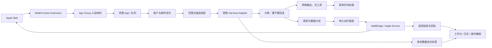
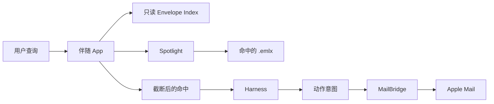

# Mailpipe 设计

状态：设计草案。更新：2026-11-16。
已有 M0 工程骨架；完整链路仍须通过 M0 验证。
定位与 PRD v0.5 对齐，见 [产品方案](docs/product.md)。
产品标题为“让你的 Agent，帮你回邮件”。
来信与草稿保存在本机，由用户授权的 Agent 起草。
当前 Agent 会调用 DeepSeek 云端模型。
架构前提不变：只调用用户本机已安装的 Harness，经 CLI 或本地 HTTP。

## 1. 要解决的问题

1. 如何在邮件不经我们服务器的前提下，收信后备好回复？
2. 如何防止不可信来信驱动 Agent，并在生成草稿前完成分拣？
3. 如何标明每封邮件实际交给了哪个 Harness 与模型厂商？
4. 如何在 Agent 中查找历史邮件，且只把命中交给模型？
5. 如何让用户看懂结果，并纠正误操作？

## 2. 架构与责任边界

| 组件 | 负责 | 不负责 |
|---|---|---|
| Action Extension | 读取可用元数据、暂存输入、及时返回 | 调用 CLI、长时间等 AI、事后回写 |
| 伴随 App | 调度、界面、策略、分拣后的草稿落点 | 取代邮件客户端，或成为中间服务器 |
| MailBridge | 账户枚举、定位、选择与状态读取、授权动作、读回 | 模型决策、直接改私有库 |
| 历史读取 | 只读查询已授权邮件库，并截断命中 | 写库、自建索引、把全库交给模型 |
| Harness Adapter | 检测、无工具的入站调用、输出解析、计量 | 让来信驱动工具，或直接操作 Mail |
| Rule Engine | 解释结构化条件、确定动作和冲突 | 执行模型生成的程序 |
| Store | 任务状态、规则版本、意图、回执与去向标签 | 保存 Harness 认证凭据 |

宿主拟用 Swift / SwiftUI，桥接 AppKit。
扩展保持沙盒化，宿主按直装方案设计。
不新增常驻服务进程；初版由宿主处理队列。
App Group 共享与宿主访问权限须签名原型验证。

## 3. 方案选择

| 方案 | 新邮件 | 异步回写 | 自定义邮箱 | 权限与成本 | 结论 |
|---|---|---|---|---|---|
| 仅 MailKit | 有公开回调 | 无公开入口 | 不支持 | 边界窄 | 不满足 PRD |
| MailKit + Apple Events | 事件采集 | 桥接执行 | 脚本字典支持 | 自动化权限、定位成本 | 推荐 M0 验证 |
| 仅 Apple Events 轮询 | 需自行扫描 | 桥接执行 | 同上 | 扫描负担、后台时机 | 只作失败后的重评选项 |
| IMAP / 服务商 API | 自建同步 | 可设计 | 可设计 | 新认证与同步栈 | 当前不做 |
| 只读邮件库 + Spotlight | 不代替新邮件回调 | 不负责回写 | 不负责移动 | 可选读库权限；格式未验证 | P1 历史查找 |

这里的“支持”仅指 API 或字典声明。
邮件库方案是已确认的设计，不是已验证的行为。
MailBridge 跨账户、跨版本行为尚未实测。

历史查找的只读路径：

写操作不进入 Envelope Index 或 `.emlx`。
索引与 Spotlight 的实际覆盖尚未验证。

## 4. 两条处理路径

| 路径 | 触发 | 输出 |
|---|---|---|
| 已授权接收来信 | MailKit 在确认的范围内收到新邮件 | 工作台显示 Agent 起草的回复 |
| 已授权自动整理 | 已确认账户范围的新邮件 | L0 规则动作和读回回执；L2 草稿落在菜单栏待处理 |

接收新来信前，用户须确认来信范围与目标 Harness。
按账户授权的任务不能依据 To/Cc 推断归属。
这些任务缺少可靠来源或正文时，保持待核对。
首次引导不把历史邮件交给模型。
历史搜索只在用户查询时读取，不预建索引。

主动服务级别见 [产品方案](docs/product.md)。
P0 是 L0、L1、L2、单封数据去向标签，以及“要不要回复”分拣。
L2 是默认级别：备好草稿，只放到菜单栏待处理。
不自动打开撰写窗口。
发送只打开草稿，不调用 send。
Mail 草稿邮箱要等实机验证，未通过前不写入。
L0 仍是静默整理。L1 只提示“这封需要回复”。
L3 白名单延迟自动发送属于 P2，须单独授权，并有日志和发出前撤销。

扩展不写“待处理”旗标。
待处理状态只显示在 Mailpipe。
原因：扩展无法读取原旗标，也无法保证稍后清除。
此调整防止覆盖用户现有标记。

## 5. 状态、身份与完成

模型完成与 Mail 动作完成分别记录。
唯一邮件定位是执行动作的前提。
Message-ID 是线索，不是跨账户唯一主键。
字段和状态机见 [数据契约](docs/data-contracts.md)。

动作写前保存原状态。
执行后重新定位，并核对目标字段。
超时、退出或连接断开进入“结果待核对”。
读回确认前，不显示“已整理”。
撤销只修改该动作曾写入的字段。
用户后续修改造成冲突时，不覆盖用户状态。

## 6. 调度与预算

| 机制 | 所有者 | 触发与边界 | 成本 / 恢复 |
|---|---|---|---|
| 持久入站材料 | Extension | Mail 回调；有大小与数量上限 | 宿主停机可积压；满额记录缺口 |
| 批处理 | App | 同账户、同路由、同策略版本 | 默认 10 封或 2 分钟，均为待测值 |
| 分拣先于草稿 | App | 入站邮件先回答“要不要回复” | 不需要回复时不生成草稿 |
| 调用串行 | Adapter | 每个 Harness 同时 1 次 | 避免抢占用户额度；上限待实测 |
| Schema 修复 | App | 可归因的输出校验错误 | 最多 1 次，计入总调用预算 |
| 暂态重试 | App | 明确未发生 Mail 写操作 | 有界；见 Harness 契约 |
| Mail 写入恢复 | MailBridge | 意图存在但缺回执 | 只读核对；未知不重放 |

这些机制对应 PRD 的重启、冷启动与限流需求。
参数是设计起点，不代表性能测量结果。
原型若不能证明必要性，应删减机制。
暂停会阻止新派发；在途写入仍需收尾核验。
恢复不自动接受旧规则下的动作计划。

## 7. 交互与安全

主工作台采用“待处理—草稿—动作回执”。
分类标签属于 Mailpipe，不宣称是 Mail 原生标签。
具体页面见 [交互设计](docs/interaction-design.md)。

邮件数据在模型边界外进行账户和权限检查。
入站调用只读，不授予工具权限。
分拣只决定要不要回复。
生成调用的输出只能是草稿。
执行器不接受任意脚本或自由格式动作。
详见 [安全设计](docs/security.md)。

## 8. 源码边界

目录已建立；下表区分当前实现与后续职责。

| 目录 | 当前实现 | 后续职责 |
|---|---|---|
| `Mailpipe/App/` | 工作台、菜单栏、工具检测 | 引导、待处理、队列与回执 |
| `Mailpipe/Assets.xcassets/` | 宿主与扩展的 AppIcon、菜单栏模板 | 随 Xcode 编入包 |
| `Mailpipe/MailExtension/` | Action handler 返回 nil | 采集与入站暂存 |
| `design/icon/` | 图标 SVG、生成脚本与 icns | 重新生成后同步资源目录 |
| `Packages/MailpipeCore/` | 分类契约、严格校验、账户路由 | 分拣、去向标签、规则与持久状态 |
| `Packages/MailBridge/` | 类型与不可用实现 | 定位、草稿落点、动作与读回 |
| `Packages/HarnessAdapters/` | 两种 CLI、进程管理、输出解析 | 真实模型受限验收 |
| `Tests/` | 24 项合成 / fake 测试 | 实机集成验收 |
| `scripts/` | 构建、隔离测试、工程生成 | 签名与发布 |

不同进程是扩展边界的理由。
不同权限与可替换 fake 是桥接层的理由。
初版不引入通用插件市场或动态脚本引擎。

## 9. 决策门槛

M0 必须证明账户归属、身份定位和动作回执。
也必须证明 Harness 可在受限环境中运行。
任一安全门槛失败，自动整理不进入 Alpha。
降级为建议模式须修改产品验收口径。
不能把降级版本写成 P0 已完成。

验证入口见 [验证计划](docs/testing.md)。
未决事项见 [已知限制](docs/known-issues.md)。

## 10. 主动回复的技术约束

前提不变。
模型只经用户本机已安装的 Harness。
接入方式是 CLI，或本机 HTTP。
App 不直连模型 API，不保管凭据，也不调用 Ollama。

本地优先在这里的含义是本地编排。
队列、策略和草稿落点都在用户的 Mac 上。
Mailpipe 不新增云端副本，也不做中间转发。
正文仍然会到达该 Harness 配置的模型厂商。

### 10.1 来信不能驱动 Agent

不可信来信不得驱动 Agent。
入站邮件的 Harness 调用是只读的，不授予任何工具权限。
这包括 Mailpipe 自己的查找工具和写意图工具。
分拣调用只返回是否回复、类别、摘要和依据。
它不能附带动作。
生成调用的输出只能是草稿。
App 把草稿放进菜单栏待处理。
实机验证通过前，不写入 Mail 草稿邮箱。
模型输出不能变成移动、发送、改规则或脚本。
用户要发送时，只打开草稿。
用户主动发起的历史查找和增删改，仍走既有工具边界。
那条路径不接受来信自行触发。
契约见 [Harness 契约](docs/harness-adapter.md) 与 [安全设计](docs/security.md)。

### 10.2 分拣先于生成

分类和摘要不再单独交付。
它们是“要不要回复”的输入。
分拣通过后才生成草稿，用来控制额度和误报。
无法判断时不生成草稿。

是否用 Apple Foundation Models 在设备上做这次预过滤，仍未决定。
见 [Q-24](docs/known-issues.md)。
那样做与当前“不直接调用模型”冲突。
该框架在国行设备上不可用。
未决定前，分拣仍走用户的 Harness。

### 10.3 草稿落点

P0 的落点只是菜单栏待处理列表。
不自动打开撰写窗口。
发送只打开草稿。
Mail 草稿邮箱要等实机验证通过才启用。
AppleScript `reply` 能否保留原线程，以及草稿能否同步到 iPhone，未验证。
该实验与 M0-02 正文重入、M0-03 移动后身份并列，编号 M0-16。
未通过前，不写入草稿邮箱，也不宣称线程保留或 iPhone 同步。
M0-16 失败不把 L2 移出 P0。
见 [邮件集成](docs/mail-integration.md) 与 [验证计划](docs/testing.md)。

### 10.4 触发时机

MailKit 在 Mail 运行并下载新邮件时回调。
Mail 没在运行时，没有这条回调。
合盖期间不承诺处理。
睡眠和 Power Nap 期间是否仍会回调，未验证，见 M0-17。
产品说法是“打开 Mac 时，回复已经备好”。

### 10.5 数据去向标签

这是 P0。
每封交给模型的邮件记录 Harness、模型厂商、模型名和证据来源。
分拣和草稿各记一条。
证据来源是检测、用户声明或未知。
未知保持未知，不写成留在本机，也不写成端侧推理。
字段见 [数据契约](docs/data-contracts.md)。
