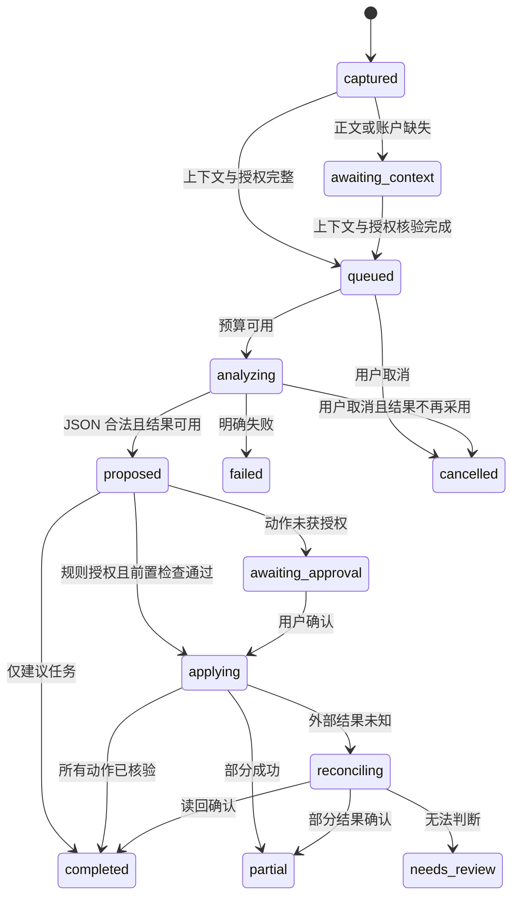

# 数据与执行契约

状态：逻辑模型草案；回复链路已有 SQLite 实现。
更新：2026-11-16。增加单封数据去向标签。

## 1. 问题与存储选择

需要区分重复输入、模型判断和实际邮件改动。
重启后必须知道哪些动作需要核对。

| 选择 | 优点 | 限制 | 推荐 |
|---|---|---|---|
| 全部 JSON 文件 | 易查看 | 多对象状态与回执难保持一致 | 只用于暂存和导出 |
| SQLite 事实库 | 本地事务、可查询 | 需迁移与恢复策略 | 宿主单写者 |
| 云端服务 | 跨设备同步 | 新增邮件外传和运维 | 不做 |

扩展仅写 App Group 暂存文件。
宿主导入到 SQLite，成为事实状态唯一写者。
此选择隔离扩展生命周期与模型长任务。
扩展不直接写宿主的业务事务。

## 2. 入站材料交接

每次回调生成独立 `ingest_id`。
先写临时文件，再原子改名为可读取状态。
文件包含版本、采集时间、阶段和内容摘要。
宿主校验大小、schema 与路径后导入。
事务提交后再删除暂存文件。
若删除前崩溃，以 `ingest_id` 去重导入。

同封邮件的多次回调不等于同一采集事件。
正文重入合并到候选邮件，不再次创建动作。
超额材料不写入；记录可见的采集缺口。
拒绝符号链接、越界路径和畸形超大材料。
App Group 权限与原子文件行为需 M0 验证。

## 3. 逻辑实体

| 实体 | 关键字段 | 不变量 |
|---|---|---|
| `AccountPolicy` | scope_id、allowed_harnesses、actions、paused、version | 模型不能修改 |
| `MessageRecord` | message_ref、ingest_ids、identity、scope、content_ref | 内部 ID 不等于 Message-ID |
| `ContentBlob` | digest、size、expires_at、truncated、source | 到期不可静默重新抓取 |
| `Rule` | rule_id、version、scope、predicate、actions、priority | 生效版本不可原地改写 |
| `Task` | task_id、message_refs、policy_version、state | 取消与暂停独立于模型结果 |
| `Run` | run_id、adapter_version、attempt、usage、error | 每次调用都记录，包括失败 |
| `DataDestination` | message_ref、run_id、harness_id、vendor、model、evidence | 一次模型调用一条；未知不写成留在本机 |
| `Decision` | message_ref、run_id、category、should_reply、evidence | 无外部效果，不等于草稿已备好 |
| `ActionIntent` | action_id、target、before、desired、rule_version | 写 Mail 前必须持久化 |
| `ActionReceipt` | action_id、observed、outcome、verified_at | 仅记录观察结果 |
| `UndoIntent` | source_action_id、expected_current、restore_fields | 不覆盖不相关字段 |
| `AuditEvent` | event_id、kind、entity_ref、time | 不存正文或凭据 |

所有时间保存 UTC，界面转换为用户时区。
更新策略版本必须使旧动作计划失效。
本地库不是远端邮箱真相；执行时必须读取 Mail。
这里的本地库指 Mailpipe 自己的事实库。
Mail 的 Envelope Index 不是这套实体的存储。

## 4. 身份与定位

`message_ref` 是 Mailpipe 生成的 UUID。
身份线索包括账户、Message-ID、日期、发件人与摘要。
Mail 数值 ID 只作当前 locator 缓存。
不承诺移动后、重建后或跨设备稳定。

| 匹配结果 | 行为 |
|---|---|
| 唯一且账户确定 | 可进入策略校验 |
| 未找到 | 等待或用户有界重新定位，不自动扫描全部 |
| 多个候选 | 人工确认，禁止自动动作 |
| Message-ID 缺失 | 不仅凭主题自动合并或执行 |
| 账户未知 | 按账户授权的任务须先核验身份 |
| 内容变化 | 原 Decision 作废，重新预览 |

去重键须绑定账户、规则版本和目标状态。
不只使用 Message-ID，也不跨账户合并内容。
完整身份算法由 M0 重复邮件测试后冻结。

## 5. Task 状态机

按账户授权的任务在来源身份核验后继续。
MailKit 回调须匹配已确认的来信范围与目标 Harness。

`completed` 必须带 `completion_kind`。
取值 `advice_only`、`draft_ready` 或 `mail_verified`。
界面分别显示“建议已生成”、“草稿已备好”和“已整理”。
`draft_ready` 不表示撰写窗口已打开，也不表示已发送。
全局暂停是派发门，不改写全部 Task 历史状态。
`applying` 不能因取消而假装动作未发生。
此时停止后续动作，并核对已发出的操作。

## 6. Mail 写入协议

1. 核对账户、暂停、规则版本与 locator。
2. 读取将修改字段的当前值。
3. 写入 ActionIntent 并提交事务。
4. 发送固定 MailBridge 操作。
5. 重新定位并读回目标字段。
6. 写入 Receipt，更新对应子动作状态。

执行与本地事务无法组成分布式原子事务。
不承诺 exactly-once 外部执行。
设计目标是去重、前置检查与可核对结果。

| 中断点 | 恢复 |
|---|---|
| 意图未提交 | 无动作可执行，安全重新计划 |
| 意图提交但未发送 | 仍需核对；不能靠内存判断未发送 |
| 操作已发送但无回执 | 只读核验；结果未知不重放 |
| 回执已写 | 不重复执行；可更新展示 |

动作读回等于目标状态，只证明状态一致。
不能据此断言变更一定由 Mailpipe 造成。
诊断中区分执行返回值与读回事实。

## 7. 规则 DSL 与冲突

结构化规则只允许固定条件和动作。

| 条件 | 求值方式 |
|---|---|
| 发件地址、域名、主题包含、账户、邮箱 | 本地确定性匹配 |
| 类别、需要行动 | 已校验的 AI Decision |
| 不支持的任意语义或程序 | 拒绝保存，提示改写 |

规则解析可调用模型，运行规则不执行生成代码。
模型分类只提供事实候选，动作来自用户确认规则。
按用户排序逐条匹配。
同字段冲突时，优先级最高的规则获胜。
不同字段可组合；界面展示最终动作集合。
移动动作始终最后执行，并再次核对定位。
未知语义条件不视作 true，转待确认。

## 8. 撤销与并发修改

撤销前比较当前值和原动作期望值。
仅恢复 Mailpipe 修改过的字段。
字段不一致、目标不存在或定位歧义时标记冲突。
多动作撤销按逆序处理，各自有新意图与回执。
不自动撤销用户后来明确确认的新规则效果。

示例：原来未读，Mailpipe 只移动邮箱。
用户后来读过邮件。撤销只移动回来，保持已读。
若用户又移动到其他邮箱，撤销不覆盖该移动。

## 9. 保留与清除（设计初值）

| 数据 | 初始策略 |
|---|---|
| 原始邮件暂存 | 导入后尽快清理；未导入最多 24 小时 |
| 清洗后的正文片段 | 最多 7 天；到期摘要可保留 |
| 摘要与动作日志 | 默认 30 天，用户可提前清除 |
| 规则与权限 | 持续保存，用户删除或卸载时选择清除 |
| Harness 会话 | 由 Harness 管理，单独说明，不能代替其删除 |

以上时长须通过隐私和恢复测试后冻结。
磁盘配额到达时停止接收内容，显示缺口。
不得为清理缓存删除尚待核验的最小动作证据。
用户清除全部数据时先停止派发并核对在途操作。
仍有未知动作时明确说明失去撤销与核对材料的后果。
清除本地库不更改 Mail 中已发生的结果。

## 10. Agent 工具契约

状态：已确认的逻辑契约，尚未实现。
工具由 Mailpipe 执行。
Harness 只看见入参校验后的出参。

| 工具 | 入参 | 出参 |
|---|---|---|
| `searchMail` | 查询文本、可选账户、可选邮箱 | 命中列表、是否截断 |
| `readMail` | 一个 `message_ref` | 元数据、正文片段、是否截断 |
| `proposeMailAction` | 动作枚举、目标、期望状态 | `intent_id`、确认状态、`not_started` |

检索出参字段只包括：`message_ref`、发件人、收件人、主题、日期、邮箱、已读、旗标和片段。
不返回数据库路径、文件路径或自动化参数。
示例地址使用 `billing@example.com`。
不使用真实邮箱。

| 上限 | 设计初值 | 状态 |
|---|---|---|
| 一次 `searchMail` 条数 | 10 | 未实测 |
| 每条检索片段 | 2 KiB | 未实测 |
| 一次 `readMail` 正文 | 16 KiB | 未实测，与分类单封上限相同 |
| 一次模型调用携带的邮件数 | 10 | 未实测 |
| 一次模型调用的正文合计 | 16 KiB | 未实测 |

超出上限时截断并标记 `truncated`。
不把未返回的其余邮件交给模型。
检索出参不写入通用日志。

`proposeMailAction` 的动作枚举：

| 动作 | 含义 | 工具返回时 |
|---|---|---|
| `create_draft` | 准备草稿 | 不调用 send |
| `create_mailbox` | 在指定账户新建邮箱 | 等待用户确认 |
| `move_to_trash` | 移到废纸篓 | 等待用户确认。不是永久删除 |
| `move` | 移动到已有邮箱 | 单封等待确认 |
| `set_read` | 已读或未读 | 单封等待确认 |
| `set_flag` | 旗标 | 单封等待确认 |

批量是指同一意图包含多于一封邮件。
批量和 `move_to_trash`、`create_mailbox` 的确认状态必须是待确认。
工具结果里的确认状态不等于 Mail 已改变。
执行仍走第 6 节。
读回完成前，回执不能写成成功。

写工具没有直接修改 Envelope Index 或 `.emlx` 的字段。
读工具以只读方式查询，查询失败不产生意图。
入站分拣和草稿不调用本节工具。

## 11. 数据去向标签

P0。每封交给 Harness 的邮件都要能回答发给了谁。
创建 `Run` 时写入一条 `DataDestination`。
分拣和草稿各记一次，不合并成含糊的“已处理”。

| 字段 | 含义 |
|---|---|
| `harness_id` | 本次实际调用的 Harness |
| `vendor` | 模型厂商。不可检测则为未知 |
| `model` | 模型名。不可检测则为未知 |
| `evidence` | `detected`、`declared` 或 `unknown` |
| `message_ref` + `run_id` | 绑定这一次调用，不跨账户合并 |

`vendor` 不是“本机”这个结论。
界面按 `message_ref` 汇总这些记录。
检测失败时显示未知，不回填成端侧推理。
用户声明不能覆盖相反的检测结果。
清除本地库会删掉标签，不会删掉厂商侧副本。
标签不授权放宽账户路由，也不授权发送。

## 12. 已实现的回复契约

2026-11-16：以下类型已有源码和隔离回归。
入口：`Packages/MailpipeCore/Sources/ReplyContracts.swift`。
回复链路持久化与菜单栏待处理已接入。
执行范围与限制见第 13 节。

| 类型 | 约束 |
|---|---|
| `ReplyTriageRequest` | 单封输入；任务为 `reply_triage` |
| `ReplyDecision` | 独立 `should_reply`；保留分类、行动判断、摘要和原文证据 |
| `ReplyDraftRequest` | 绑定原始输入，宿主限定本次允许的结果 |
| `ReplyDraftOutcome` | 首次自动处理可返回草稿或明确的 `no_reply` |
| `ReplyDraft` | 只含关联 ID、主题和正文；无收件人或动作 |
| `ServiceLevel` | L0、L1、L2；默认 L2；不含 L3 |
| `DataDestination` | 绑定邮件、调用、任务和 Harness；独立保存证据 |

分拣与草稿使用独立 schema，版本均为 1。
它们不替换 M0 分类探针的旧 schema。
未知字段、错误关联 ID 和越界输出均被拒绝。
草稿主题拒绝控制字符，正文最多 16 KiB。
使用分拣决策创建草稿请求时，须取得 L2 的 yes。
L1 的 yes 只产生 `needsReply` 展示意图。
L0 不产生回复展示或草稿意图。
这不代表 L0 的整理执行已经实现。

校验后的分拣绑定原始 `MailInput`。
内容改变后，必须重新分拣。
反序列化决策不能直接用于起草。
恢复后须结合原请求重新校验。

去向未知时，厂商和模型为空。
已声明或已检测的去向至少包含厂商或模型之一。
Claude Code 或 OpenCode 返回模型名时，厂商可以为空。
OpenClaw 和 Hermes Agent 核对官方 DeepSeek 路由及模型后记录去向。
该类型仅表达证据，不自行检测厂商。
本轮 DeepSeek 探针从受限运行事件确认去向。
未取得完整可信事件时，失败记录保留未知。
缺失 token 和实付金额表示未知，不表示零。

验证结果见 [回复契约验收](validation/2026-11-16-reply-contracts.md)。

## 13. 已实现的持久化回复链路

入口：`Packages/MailpipeRuntime/Sources/`。
SQLite 使用 records、ingests、metadata 三张表。
Task、Run、Decision 和草稿存于同一记录中。
单次事务提交后才删除扩展暂存材料。
账户策略在 metadata 内，模型不能修改。
完整规则、动作意图和撤销实体仍未实现。

未知账户先停留在 `awaitingAccount`。
在授权账户内，Message-ID 必须唯一匹配。
同时校验主题与来源证据。
新记录核对稳定头字段和完整 MIME 正文摘要。
已采集的顶层 MIME 参数必须一致。
来源证据允许恢复 MailKit 丢失的 MIME 参数。
证据不足或旧记录仍要求整封规范化摘要一致。
范围及限制见 [邮件集成](mail-integration.md)。
随后用账户、locator、内容去重。
正文重入只合并唯一的空候选，不合并两封完整邮件。

| 状态 | 恢复方式 |
|---|---|
| awaitingBody | 等待正文回调，不派发模型 |
| awaitingAccount / queued | 核验当前权限后接续 |
| triaging / drafting | 转 needsReview，不自动重放 |
| draftQueued | 重验存储决策与策略版本，只接续草稿 |
| draftReady / needsReply | 直接显示，不再次调用 |
| noReply | 保留处理记录，重启后不重新起草 |
| needsReview / cancelled | 不自动重试 |

全局暂停单独持久化。
账户、处理范围、模型路径或级别变更会更新策略版本。
派发前与采用结果前均核验权限。
调用被暂停或撤权时，保留调用证据并丢弃输出。

当前有容量和派发时效上限。
自动保留期清理未实现，不把时效校验当作删除。
导入时提取可用预览，并保存来源证据。
有来源证据的记录须核对唯一授权原文。
缺少 MIME 参数时先待确认账户，不直接拒绝。
分拣正文从核验后的完整原文提取。
模型只看最多 16 KiB。
提取失败时记录原因，状态为 needsReview。
格式、上限和未覆盖项见 [邮件集成](mail-integration.md) 的正文提取。
完整验收和限制见 [持久化链路记录](validation/2026-11-16-persistent-reply-pipeline.md)。
