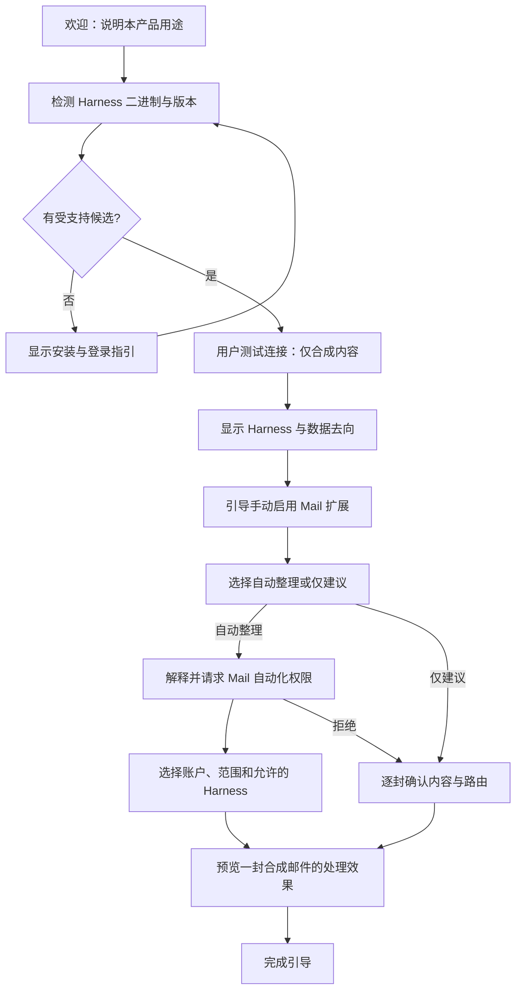

# 交互设计

状态：低保真交互规格，尚无可点击原型。
更新：2026-11-15。范围见 [产品方案](product.md)。

## 1. 设计问题与选择

| 选择 | 优点 | 限制 | 推荐 |
|---|---|---|---|
| 仅菜单栏弹窗 | 轻、随时可用 | 长摘要与规则编辑拥挤 | 仅作状态入口 |
| 菜单栏 + 独立工作台 | 队列、规则和回执能并排展示 | 增加一个窗口 | 主方案 |
| Mail 内侧栏 | 贴近邮件 | MailKit 不提供此扩展位置 | 不采用 |

用户要明确三件事：处理了什么、改了什么、如何纠正。
“分类完成”和“已在 Mail 整理”不能共用状态。
默认不弹出每封邮件通知，不抢走 Mail 焦点。

## 2. 信息架构

```text
菜单栏 Mailpipe
├─ 状态：运行中 / 已暂停 / 需要处理
├─ 待处理数量、需确认数量
├─ 当前 Harness 与数据去向
├─ 打开工作台
├─ 处理 Mail 当前选中邮件（需自动化权限）
├─ 暂停自动处理 / 恢复
├─ 设置
└─ 退出 Mailpipe

工作台
├─ 需行动（跨类别视图）
├─ 全部已采集邮件
├─ 待确认 / 失败
├─ 今日摘要（P1）
├─ 规则
├─ 处理日志
└─ 设置：账户与范围 / Harness / 权限 / 数据
```

类别是 Mailpipe 筛选，不是 Mail 原生标签。
工作台不提供收信、邮箱密码或发信服务器设置。

## 3. 首次启动



| 步骤 | 展示 | 操作与退出条件 |
|---|---|---|
| 欢迎 | “整理 Apple Mail，复用你的 AI 工具” | 继续或退出 |
| Harness 检测 | 名称、路径、版本、支持状态 | 重新检测；未找到时给安装链接 |
| 测试连接 | “测试会消耗一次调用，不包含邮件” | 用户点击测试；失败显示原因 |
| 数据去向 | 本地 / 云端 / 未知及信息来源 | 明确确认；未知不伪装成本地 |
| 扩展 | Mail 设置中的手动启用步骤 | 状态无法自动读取时显示“待验证” |
| 自动化 | 用于读取账户、定位和整理邮件 | 允许或仅使用建议模式 |
| 范围 | 账户、邮箱、允许动作、路由 | 默认不处理未选中的账户 |
| 起步 | 合成示例与动作前后对比 | 确认后只接收未来新邮件 |

不在首次启动扫描全部历史邮件。
通知权限在用户首次设置 Digest 时申请。
登录失败时引导用户在 Harness 自身完成登录。
不让用户在 Mailpipe 粘贴 API Key 或登录令牌。

## 4. 主工作台低保真布局

```text
┌ Mailpipe ───────────── 运行中    暂停 ───── 设置 ┐
│ 需行动  │ 队列：全部 / 待处理 / 待确认           │
│ 全部    │ 发件人  主题  类别  状态  时间         │
│ 待确认  │ 示例商店 订单摘要 账单 已整理           │
│ 规则    ├─────────────────────────────────────┤
│ 日志    │ 订单摘要                             │
│         │ 3 行摘要；需行动：否                  │
│         │ 依据：原文片段；内容已截断时提示      │
│         │ 规则：账单归档 v2                    │
│         │ 动作：收件箱 → 发票；已核验          │
│         │ [在 Mail 打开] [纠正分类] [撤销]     │
├─────────┴─────────────────────────────────────┤
│ Harness：已选工具 · 模型未知 · 数据去向未知     │
└───────────────────────────────────────────────┘
```

布局目标：窗口可缩放，优先使用系统控件。
窄窗口将详情切为独立页，并保留返回位置。
颜色不是唯一状态信号，始终附文字或图标。
列表时间为收到时间；详情另列处理时间。
二者均按用户系统时区显示，并在详情标出时区。

列表只显示已采集的数据，不声称是整个收件箱。
正文缺失、线程不完整和历史覆盖缺口都需标注。
“在 Mail 打开”失败时保留摘要，显示定位失败原因。
定位歧义时要求选择候选，不随意打开或修改第一封。

## 5. 状态与恢复

| 界面状态 | 含义 | 主操作 | 禁止误导 |
|---|---|---|---|
| 等待正文 | 只有元数据 | 查看原因 | 不生成完整正文摘要 |
| 待确认账户 | 无可靠账户归属 | 确认该邮件路由 | 不自动选择云端 Harness |
| 排队 / 分析中 | 模型尚未结束 | 取消本次处理 | 不显示已整理 |
| 建议已生成 | 分类完成，未写 Mail | 预览动作 / 保留建议 | 不计入整理成功 |
| 等待授权 | 动作超出范围或权限被撤销 | 调整权限 / 放弃动作 | 不循环弹系统权限框 |
| 执行中 | 已提交 Mail 操作 | 查看详情 | 禁止重复点击 |
| 结果待核对 | 超时或回执丢失 | 核对结果 | 不提供“再执行一次” |
| 已整理 | 读回与目标一致 | 撤销 / 在 Mail 打开 | 模型成功不能进入此状态 |
| 部分完成 | 多个字段只完成一部分 | 查看各动作 | 不显示整条规则成功 |
| 失败 | 已明确失败且无不明外部效果 | 查看原因 / 有界重试 | 不隐藏错误 |
| 已暂停 | 用户暂停全局或账户 | 恢复 | 不自行恢复 |

空列表：“还没有采集到邮件”。
无 Harness：“连接一个已安装的 AI 工具”。
队列满：“有邮件未入队，请稍后手动补处理”。
模型限流：“当前工具暂不可用，未切换到未授权工具”。
恢复时重查规则版本、路由与邮箱状态。

## 6. 自然语言规则

流程：输入 → 解析 → 预览 → 确认 → 保存。
示例：“把账单放到发票邮箱，保持未读状态”。

```text
规则：账单归档
范围：已选账户 / 收件箱 / 未来新邮件
条件：AI 分类 = 账单
动作：移动到 [已选择的发票邮箱]
已读与旗标：保持原值
应用方式：自动执行已授权动作
冲突优先级：第 2 条
预览：匹配 3 / 不匹配 7 / 无法判断 1
[查看逐封原因] [返回修改] [确认保存]
```

| 边界 | 交互要求 |
|---|---|
| 自定义邮箱不存在 | 让用户在 Mail 创建后刷新；不凭名称自动创建 |
| 无最近样本 | 显示样本不足；允许保存但不声称已验证 |
| 预览需模型 | 显示范围、Harness 与预计调用；用户启动 |
| 多规则冲突 | 显示获胜规则与被覆盖动作 |
| 语义无法表达 | 标明不支持的部分，不静默丢弃 |
| 编辑规则 | 新版本只作用于未来任务；旧计划重新确认 |
| 停用规则 | 取消未开始的动作；在途动作仍核对 |
| 历史应用 | 独立选择时间和数量，先预览，再确认 |

预览绝不修改 Mail。
历史重跑是显式操作，不由规则保存顺带触发。
误分类只纠正当前结果；创建新规则另行预览。

## 7. 日志与撤销

日志显示邮件、规则版本、动作、时间和结果。
展开后显示原值、目标值、实际读回值。
技术错误详情放在次级面板，默认显示可理解原因。

撤销按钮仅在有原始快照且目标可定位时出现。
点击后先检查当前字段是否仍等于 Mailpipe 写入值。
冲突提示：“邮件已发生变化，未覆盖当前状态”。
不以撤销覆盖用户手动移动或修改的字段。
原邮箱不存在时，要求用户选择恢复目标。
批量撤销逐条报告成功、冲突和失败。

## 8. P1 起草与交接

入口：邮件详情“起草回复”，或“新邮件”。
摘要生成不得自动触发起草。

| 步骤 | 界面与约束 |
|---|---|
| 输入意图 | 展示将使用的邮件与 Harness |
| 生成 | 允许取消；用户编辑内容不被后台覆盖 |
| 预览 | To/Cc/Bcc、主题、正文、附件逐项可见 |
| 风险提示 | 新收件人、外部域、Reply-To 差异、占位符 |
| 交接 | 按钮名为“在 Mail 中打开”，不用“发送” |
| 交接完成 | 显示“已交给 Mail，发送状态未核验” |
| 交接失败 | 保留草稿，允许复制；不自动重复开窗口 |

附件必须来自用户明确选择的文件。
模型建议的路径不自动读取或附加。
若不能保留回复线程，显示“将作为新邮件打开”。
用户可改选复制内容到原回复窗口。
发件账户无法固定时，在交接前提示用户核对。
Mail 内修改后的内容不保证同步回 Mailpipe。

## 9. P1 Digest 与设置

Digest 标明时间范围、覆盖数量、失败和待处理数量。
系统通知默认不展示正文、收件人或敏感主题。
点击通知打开 Mailpipe 对应摘要。
重复启动不重复发送同一摘要通知。
定时任务只在宿主可运行时执行；补发策略待 P1 细化。

设置支持账户暂停、允许的 Harness 顺序和调用上限。
去向变更后，新任务使用新版本策略。
待执行动作需重查授权，不沿用失效的许可。
“清除本地数据”先暂停，并说明影响范围。
不承诺清除 Harness 自身的会话或云端记录。

## 10. 键盘与可访问性

支持 Tab 顺序、VoiceOver 标签与系统字号。
`⌘,` 打开设置，`Esc` 关闭当前预览。
删除、撤销和执行按钮不能仅靠颜色区分。
加载与错误信息要被辅助技术读到。
关键流程覆盖浅色、深色和窄窗口验收。

## 11. 未覆盖与重评

P2 自动发送尚无交互定稿。
多窗口同步、超大队列分页在 Alpha 后实测。
若桥接无法稳定定位，隐藏自动执行入口并重评范围。
完整验收场景见 [验证计划](testing.md)。
