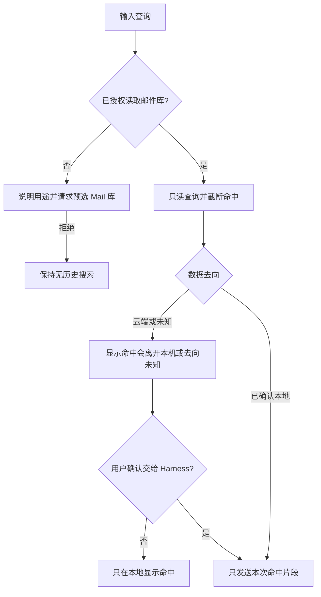

# 交互设计

状态：历史交互规格，包含未实现的后续能力。
更新：2026-11-17。范围见 [产品方案](product.md)。

本轮 UI 已改为原生分栏与标准设置窗。
主路径为审阅、编辑、复制，再到 Mail 粘贴发送。
Mail 交接、历史搜索和规则等未实现入口隐藏。
下方旧线框不再作为视觉依据。
旧表中的 Mail 打开按钮不代表当前产品入口。
实现范围、运行截图与限制见 [原生 UI 验证](validation/2026-11-17-native-ui.md)。
草稿详情 v1.2 改为正文主编辑面和固定动作栏。
保存恢复与候选选择见 [详情修订验证](validation/2026-11-17-draft-detail-v12.md)。

## 1. 设计问题与选择

| 选择 | 优点 | 限制 | 推荐 |
|---|---|---|---|
| 仅菜单栏弹窗 | 轻、随时可用 | 长摘要与规则编辑拥挤 | 仅作状态入口 |
| 菜单栏 + 独立工作台 | 队列、规则和回执能并排展示 | 增加一个窗口 | 主方案 |
| Mail 内侧栏 | 贴近邮件 | MailKit 不提供此扩展位置 | 不采用 |

用户要明确四件事：回复备好没有、发给了哪家厂商、改了什么、如何纠正。
“草稿已备好”“分类完成”和“已在 Mail 整理”不能共用状态。
默认不弹出每封邮件通知，不抢走 Mail 焦点。
不自动打开撰写窗口。

## 2. 信息架构

```text
菜单栏 Mailpipe
├─ 最近三封待处理邮件
├─ 待处理 n
├─ 可回复邮件数
├─ 打开工作台
└─ 退出 Mailpipe

工作台
├─ 待处理（L1 提示与 L2 草稿）
├─ 需行动（跨类别视图）
├─ 全部已采集邮件
├─ 待确认 / 失败
├─ 搜索历史邮件（P1，需历史读取授权）
├─ 今日摘要（P1）
├─ 规则
├─ 处理日志
└─ 设置：账户与范围 / 服务级别 / Harness / 权限 / 数据
```

菜单栏使用 macOS 原生下拉菜单。
点邮件会在工作台选中对应来信。
「待处理 n」显示工作台的未读草稿总数。
可回复邮件数与每日提醒使用同一口径。
点数量可查看最新一封可回复邮件。
提醒时间和系统通知授权入口位于通用设置。
「打开工作台」保留当前选中的来信。
暂停和恢复入口位于 App 的通用设置。
用户在「设置 → 回复」编辑提示词，保存后用于下次起草。
清空后保存即可恢复默认。已有草稿可在工作台或 Mail 回复面板重新生成。

类别是 Mailpipe 筛选，不是 Mail 原生标签。
工作台不提供收信、邮箱密码或发信服务器设置。

## 3. 首次启动

首次打开时只展示设置向导。
每页用一段用途说明和一段本地 Lottie 动画引入操作。
启用“减弱动态效果”时保留静止插图。
权限页参考 Alfred 设置助手，从说明直达对应设置。[Alfred 设计说明](https://www.alfredapp.com/blog/productivity/polishing-alfreds-onboarding-experience/)

| 步骤 | 用户看到的内容与操作 |
|---|---|
| 看效果 | 标题为“让你的 Agent，帮你回邮件”。预览示例来信和草稿，说明本机保存、授权起草和亲自发送 |
| 连接 Agent | 用示例邮件测试一次 DeepSeek Harness。连接前说明 DeepSeek 云端模型会收到内容，调用可能消耗额度 |
| 设置 Mail 扩展 | 打开 Mail 扩展设置，勾选 Mailpipe 后回来确认 |
| 选择来信范围 | 接收所有账户今后的新邮件，也可限定完整主题 |
| 复核授权 | 核对工具和来信范围，点“开始使用”。保存成功后直接进入工作台 |

向导按钮沿用工作台的尺寸和样式。
关闭窗口后保留当前步骤。
再次启动、点击 Dock、使用菜单栏或 ⌘1 都能接续。
完成首次授权后，这些入口打开工作台。
旧版手动模式保留已有草稿。接收新来信需在设置中确认扩展、范围与 Agent。
历史设计与权限边界见[新手引导 PRD](onboarding.md)。
窗口恢复与授权结果见[紧凑引导验收](validation/2026-11-19-compact-onboarding.md)。

设置草案与生效策略必须分开。
返回、保存或关闭向导不产生新的授权。
不扫描历史邮件，也不补处理未授权积压。
既有授权队列恢复前重查当前权限。
已开始但结果未知的调用不自动重放。
重新引导保留暂停、权限范围和关闭的规则。

历史搜索、通知与登录启动按需引导。
首次设置不申请历史库读取权限。
不让用户在 Mailpipe 粘贴 API Key 或登录令牌。

## 4. 主工作台低保真布局

```text
┌ Mailpipe ───────────── 运行中    暂停 ───── 设置 ┐
│ 待处理  │ 队列：待处理 / 全部 / 待确认           │
│ 需行动  │ 发件人  主题  分拣  状态  时间         │
│ 全部    │ 示例商店 订单 需要回复 草稿已备好       │
│ 待确认  ├─────────────────────────────────────┤
│ 规则    │ 订单摘要                             │
│ 日志    │ 要不要回复：是；草稿已在待处理        │
│         │ 依据：原文片段；内容已截断时提示      │
│         │ 本封去向：已选 Harness · 厂商未知     │
│         │ 动作：未改 Mail；未打开发送窗口      │
│         │ [查看草稿] [在 Mail 打开] [撤销]     │
├─────────┴─────────────────────────────────────┤
│ 当前路由：已选工具 · 模型未知 · 去向未知        │
└───────────────────────────────────────────────┘
```

布局目标：窗口可缩放，优先使用系统控件。
窄窗口将详情切为独立页，并保留返回位置。
颜色不是唯一状态信号，始终附文字或图标。
列表时间为收到时间；详情另列处理时间。
二者均按用户系统时区显示，并在详情标出时区。

列表只显示已采集的数据，不声称是整个收件箱。
正文缺失、线程不完整和历史覆盖缺口都需标注。
“在 Mail 打开”失败时保留摘要，显示定位失败原因。
定位歧义时要求选择候选，不随意打开或修改第一封。

## 5. 状态与恢复

| 界面状态 | 含义 | 主操作 | 禁止误导 |
|---|---|---|---|
| 等待正文 | 只有元数据 | 查看原因 | 不生成完整正文摘要 |
| 待确认账户 | 无可靠账户归属 | 确认该邮件路由 | 不自动选择云端 Harness |
| 排队 / 分析中 | 模型尚未结束 | 取消本次处理 | 不显示已整理 |
| 需要回复 | L1，尚未生成草稿 | 查看依据 | 不假装草稿已备好 |
| 草稿已备好 | L2，已在菜单栏待处理 | 查看草稿 / 在 Mail 中打开 | 不自动打开撰写窗口；发送只打开草稿；不显示已发送 |
| 建议已生成 | 分拣完成，未写 Mail | 预览动作 / 保留建议 | 不计入整理成功 |
| 等待授权 | 动作超出范围或权限被撤销 | 调整权限 / 放弃动作 | 不循环弹系统权限框 |
| 执行中 | 已提交 Mail 操作 | 查看详情 | 禁止重复点击 |
| 结果待核对 | 超时或回执丢失 | 核对结果 | 不提供“再执行一次” |
| 已整理 | 读回与目标一致 | 撤销 / 在 Mail 打开 | 模型成功不能进入此状态 |
| 部分完成 | 多个字段只完成一部分 | 查看各动作 | 不显示整条规则成功 |
| 失败 | 已明确失败且无不明外部效果 | 查看原因 / 有界重试 | 不隐藏错误 |
| 已暂停 | 用户暂停全局或账户 | 恢复 | 不自行恢复 |

空列表：“还没有采集到邮件”。
无 Harness：“连接一个已安装的 AI 工具”。
队列满：“有邮件未入队，请稍后手动补处理”。
模型限流：“当前工具暂不可用，未切换到未授权工具”。
恢复时重查规则版本、路由与邮箱状态。

## 6. 自然语言规则

流程：输入 → 解析 → 预览 → 确认 → 保存。
示例：“把账单放到发票邮箱，保持未读状态”。

```text
规则：账单归档
范围：已选账户 / 收件箱 / 未来新邮件
条件：AI 分类 = 账单
动作：移动到 [已选择的发票邮箱]
已读与旗标：保持原值
应用方式：自动执行已授权动作
冲突优先级：第 2 条
预览：匹配 3 / 不匹配 7 / 无法判断 1
[查看逐封原因] [返回修改] [确认保存]
```

| 边界 | 交互要求 |
|---|---|
| 自定义邮箱不存在 | 规则保存不自动建邮箱。可另提新建意图，确认后才执行 |
| 无最近样本 | 显示样本不足；允许保存但不声称已验证 |
| 预览需模型 | 显示范围、Harness 与预计调用；用户启动 |
| 多规则冲突 | 显示获胜规则与被覆盖动作 |
| 语义无法表达 | 标明不支持的部分，不静默丢弃 |
| 编辑规则 | 新版本只作用于未来任务；旧计划重新确认 |
| 停用规则 | 取消未开始的动作；在途动作仍核对 |
| 历史应用 | 独立选择时间和数量，先预览，再确认 |

预览绝不修改 Mail。
历史重跑是显式操作，不由规则保存顺带触发。
误分类只纠正当前结果；创建新规则另行预览。

## 7. 日志与撤销

日志显示邮件、规则版本、动作、时间和结果。
展开后显示原值、目标值、实际读回值。
技术错误详情放在次级面板，默认显示可理解原因。

撤销按钮仅在有原始快照且目标可定位时出现。
点击后先检查当前字段是否仍等于 Mailpipe 写入值。
冲突提示：“邮件已发生变化，未覆盖当前状态”。
不以撤销覆盖用户手动移动或修改的字段。
原邮箱不存在时，要求用户选择恢复目标。
批量撤销逐条报告成功、冲突和失败。

## 8. 草稿落点与交接

L2 属 P0，并且是默认级别。
分拣判定需要回复后，把草稿放进菜单栏待处理。
Mail 草稿邮箱要等实机验证，未通过前不写入。
不自动打开撰写窗口。
发送只打开草稿。
分拣未通过时不生成草稿。
用户仍可从详情主动“起草回复”或“新邮件”。
那一次是用户发起，不替代入站路径的无工具限制。

| 步骤 | 界面与约束 |
|---|---|
| 入站落点 | 菜单栏待处理；标明本封去向。草稿邮箱未验证前不出现 |
| 输入意图 | 仅用户主动起草时展示将使用的邮件与 Harness |
| 生成 | 允许取消；用户编辑内容不被后台覆盖 |
| 预览 | To/Cc/Bcc、主题、正文、附件逐项可见 |
| 风险提示 | 新收件人、外部域、Reply-To 差异、占位符 |
| 交接 | 按钮名为“在 Mail 中打开”，不用“发送” |
| 交接完成 | 显示“已交给 Mail，发送状态未核验” |
| 交接失败 | 保留待处理中的草稿，允许复制；不自动重复开窗口 |

附件必须来自用户明确选择的文件。
模型建议的路径不自动读取或附加。
若不能保留回复线程，显示“将作为新邮件打开”。
用户可改选复制内容到原回复窗口。
发件账户无法固定时，在交接前提示用户核对。
Mail 内修改后的内容不保证同步回 Mailpipe。

## 9. P1 Digest 与设置

Digest 标明时间范围、覆盖数量、失败和待处理数量。
系统通知默认不展示正文、收件人或敏感主题。
点击通知打开 Mailpipe 对应摘要。
重复启动不重复发送同一摘要通知。
定时任务只在宿主可运行时执行；补发策略待 P1 细化。

设置支持服务级别、账户暂停、允许的 Harness 顺序和调用上限。
默认级别是 L2。
L3 不出现为已授权发送。
去向变更后，新任务使用新版本策略。
待执行动作需重查授权，不沿用失效的许可。
“清除本地数据”先暂停，并说明影响范围。
不承诺清除 Harness 自身的会话或云端记录。

## 10. 键盘与可访问性

支持 Tab 顺序、VoiceOver 标签与系统字号。
`⌘,` 打开设置，`Esc` 关闭当前预览。
删除、撤销和执行按钮不能仅靠颜色区分。
加载与错误信息要被辅助技术读到。
关键流程覆盖浅色、深色和窄窗口验收。

## 11. Agent 内的历史搜索与操作

入口在工作台搜索，不在首次引导中自动执行。
未授予历史读取权限时，搜索不可用。
新邮件队列、规则和草稿保持可用。



“已确认本地”只接受检测或已记录的证据。
用户口头说本地时，仍走云端或未知那条确认。
账户未知的命中不自动进入 J。

搜索结果列出发件人、主题、日期、邮箱和截断说明。
示例只使用 `example.com` 地址。
打开原文仍交给 Mail，定位失败时不改第一封。

Agent 提出的写操作先显示意图，不显示“已完成”。

| 操作 | 确认界面 | 完成后 |
|---|---|---|
| 单封移动、已读、旗标 | 原值与目标值 | 读回后才显示已更改 |
| 多于一封 | 数量、账户和每封目标 | 逐封报告成功、冲突、失败 |
| 移到废纸篓 | 明确写“不是永久删除” | 可按条件撤销回原邮箱 |
| 新建邮箱 | 账户与名称 | 失败时不假装邮箱已存在 |
| 起草 | 沿用草稿预览 | 按钮仍是“在 Mail 中打开”；发送只打开草稿；不自动弹出 |

结果未知时只有核对，没有“再执行一次”。
永久删除不出现在操作列表中。
撤销冲突时提示未覆盖当前状态。

## 12. 未覆盖与重评

P2 的 L3 尚无交互定稿。
定稿前必须看见白名单、延迟、发送日志和发出前撤销。
多窗口同步、超大队列分页在 Alpha 后实测。
若桥接无法稳定定位，隐藏自动执行入口并重评范围。
历史库或 Spotlight 未通过验证时，保留搜索入口但显示不可用。
不改用全盘访问或辅助功能代替。
完整验收场景见 [验证计划](testing.md)。
