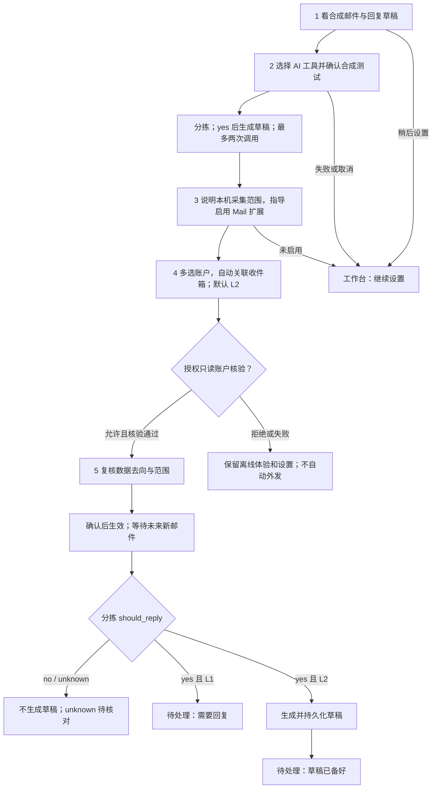

# 新手引导 PRD（v0.2）

版本：v0.2。
状态：五步向导、设置草案和进度恢复已有本地实现。
变更：默认 L2；首封草稿为主线；核验与整理授权分离。
补充：两阶段测试成本、授权队列恢复和当前实现证据。
更新：2026-11-16。
范围：P0 首次设置、首封体验与中断恢复。
P1 仅规定功能首次使用时的授权入口。
本页描述目标体验，不代表功能已经实现。

## 1. 问题与目标

安装 App 后，用户仍需启用 Mail 扩展。
用户还要确认 AI 工具、数据去向和邮件范围。
这些步骤分散在 Mailpipe、Mail 与系统设置。
如果只显示权限清单，用户难以理解价值。
如果提前显示“完成”，又会掩盖链路故障。

引导应让用户完成三个判断：

1. 看懂收到需要回复的邮件后，草稿如何提前备好。
2. 知道邮件交给谁，以及允许修改什么。
3. 知道草稿是否已备好，以及如何从菜单栏查看。

首要用户已使用 Apple Mail，并装有受支持的 AI 工具。
未安装工具的用户可先看离线示例。
引导不负责注册邮箱、迁移客户端或托管模型凭据。

## 2. 依据与取舍

| 来源 | 采用的结论 | 本 PRD 的落点 |
| --- | --- | --- |
| S1 产品 PRD §2、§5 | 面向已有 Harness 的用户 | 自动发现候选，明确兼容状态 |
| S1 §8 | 本机工具不等于本地推理 | 调用前展示数据去向与成本提示 |
| S1 §6.3 | 历史搜索单独授权 | 不放入首次设置 |
| S2 竞品调研 §3.2 | 逐项说明权限，预选目标目录 | 每项说明用途、影响与拒绝出口 |
| S2 §3.2、§11 | 安装截图缺版本等信息 | 只借鉴交互，不推定技术实现 |
| S2 §10 | 上下文集中在一处 | 示例、摘要和动作预览同屏 |
| S3 仓库交互与安全设计 | 未知账户不自动交给模型 | 逐封确认，不猜测账户 |
| S4 Apple 使用说明 | 扩展安装后仍须手动启用 | 独立的启用指导与状态核对 |

竞品的目录预选值得借鉴。
但 Mailpipe 首次设置不需要三项目录授权。
不申请辅助功能，也不索取邮箱密码或 OAuth。
不因用户拒绝，改走更广的权限渠道。

### 2.1 方案比较

| 方案 | 优点 | 代价 | 结论 |
| --- | --- | --- | --- |
| 启动即申请全部权限 | 设置集中 | 未见价值就交出权限 | 不采用 |
| 完全按需，无首次向导 | 初始阻力小 | 多处失败，难判断是否可用 | 不采用 |
| 短向导加按需授权 | 价值、权限和结果连续 | 需维护跳过与恢复状态 | 推荐 |

推荐短向导包含五步。
每步支持返回，已完成项可修改。
“稍后设置”进入工作台，保留未完成事项。
不增加额外的“启用新手引导”开关。

## 3. 范围与完成定义

| 层级 | 本次定义 | 界面措辞 |
| --- | --- | --- |
| 示例体验 | 离线展示需要回复的邮件与草稿 | 示例已体验 |
| AI 测试 | 固定合成输入完成分拣和 L2 草稿校验 | 备稿测试通过 |
| 配置保存 | 用户已复核并授权，扩展收信尚无证据 | 已授权，等待新邮件验证 |
| 设置验证 | 当前配置的采集、账户与模型链路已有有效证据 | 当前设置已验证 |
| 首封 L1 | 合格邮件被判为需要回复，不生成草稿 | 需要回复 |
| 首封 L2 | 分拣为 yes，草稿持久化并进入待处理 | 首封草稿已备好 |
| 整理结果 | 另获授权的 Mail 动作执行后读回一致 | 整理已核验 |

L2 是默认级别，属于 P0。
分类与摘要只是回复分拣的辅助信息。
草稿只进入菜单栏待处理，不自动打开撰写窗口。
未通过 Mail 草稿邮箱验收前，不写入该邮箱。
发送交接只能由用户发起，不调用 send。

点击“我已启用”不是扩展运行证据。
版本检查成功不等于备稿测试通过。
合成测试通过不等于真实收信链路已验证。
草稿备好不等于写入 Mail，更不等于已发送。

P0 必须提供示例、AI 测试、扩展指导和授权复核。
必须提供拒绝出口、进度恢复和首封草稿状态。
P1 用户主动起草、历史搜索和通知另行引导。
L2 草稿展示不依赖 P1，也不依赖整理规则。
P2 自动发送不在本向导中出现。

## 4. 主流程

L0 不进入回复提示或草稿分支。
Mail 整理动作是独立授权，不是 L2 的前置步骤。
关闭向导、返回或保存草案不会默许授权。
未完成最终复核前，不启动新的自动处理范围。
用户主动点击合成测试，是对该次合成调用的许可。

首次设置不扫描历史邮件，不补处理未授权积压。
配置生效前采集且未获授权的邮件，不自动分析。
既有授权下的队列属于恢复，不属于历史补处理。
恢复前重查当前权限、策略版本和内容时效。
已开始但结果未知的调用转待核对，不自动重放。
未启用扩展时只保存草案，不派发新邮件。
用户已手动启用但状态无法读取时，可确认授权。
此时显示“已授权，等待新邮件验证”。
首封有效事件到达后，按授权核验并处理。

## 5. 页面设计

### 5.1 第一步：看看它能做什么

标题：“继续用 Apple Mail，收信即备好回复”。
说明：“邮件不经我们的服务器，仍会交给所选模型厂商。”

| 区域 | 示例 |
| --- | --- |
| 来源 | 合成同事，colleague@example.com |
| 主题 | 请确认收到项目简报 |
| 原文 | 请回复确认收到这份示例项目简报。 |
| 分拣 | 需要回复；依据是原文的确认请求 |
| 草稿 | 已收到示例项目简报，谢谢。 |
| 落点 | 菜单栏待处理 |
| 状态 | 离线演示，未读取邮件、未调用模型、未发送 |

主按钮：“开始设置”。
次按钮：“稍后设置”。
不要求注册 Mailpipe 账户。
不在此弹出系统权限请求。
示例始终标注“合成内容”。
演示不冒充真实回执，不以分类或移动作为首要价值。

### 5.2 第二步：连接你的 AI 工具

页面默认使用“AI 工具”这一称呼。
详情说明它对应已安装的 Agent Harness。

自动发现只检查路径、版本与能力。
不得通过读取凭据来推定登录状态。
发现多个候选时，由用户选择一个。
不自动选择云端候选，也不默认配置回退。

| 状态 | 展示与操作 |
| --- | --- |
| 未找到 | 支持列表、官方安装与登录指引、重新检测 |
| 已发现 | 工具名、版本、兼容状态；路径放详情 |
| 安全能力未验收 | 可看示例；禁止提交真实邮件 |
| 未登录或连接失败 | 引导去工具自身处理，再由用户测试 |
| 测试通过 | 展示分拣依据与生成草稿；继续设置 |

测试前显示：“最多调用两次：先判断要不要回复，再生成草稿。”
补充：“只发送合成内容，消耗所选 AI 工具的额度。”
按钮：“测试分拣与备稿”。

每次点击只创建一个测试任务，不自动重试。
测试固定使用明确需要回复的合成样本。
只有分拣为 yes 且选择 L2 测试，才调用草稿阶段。
分拣为 no/unknown 时不继续，不显示完整测试通过。
显示“分拣完成，备稿未验证”，保留结果用于排查。
测试中按钮不可重复提交，并可取消。
取消后若用量未知，显示“用量待确认”。
响应结构错误与连接错误分别报告。

数据卡固定显示工具、模型、去向和依据。
模型无法识别时显示“未知”。
去向未知时说明“模型厂商未知，不代表内容留在本机”。
不得以“本机已安装”推定“本地推理”。
已知云端显示提供方；无法确认时不编造名称。

调用前说明已知厂商、模型及未知项。
用户确认这些信息后，才发起合成调用。
调用后按实际运行证据更新去向，不覆盖旧记录。
分拣与草稿分别显示调用次数、用量和结果。
真实邮件授权在第五步另行复核。
切换工具后，清除旧测试结果及对应确认。
不要求用户在 Mailpipe 输入 Key 或登录令牌。

### 5.3 第三步：启用 Apple Mail 扩展

标题：“让 Mailpipe 接收新邮件”。
核心文案：“扩展已随 App 提供，无需另外下载。”

展示三个步骤：

1. 打开 Apple Mail。
2. 进入“邮件 → 设置 → 扩展”。
3. 勾选 Mailpipe，并确认 Mail 显示的权限。

主按钮：“打开 Apple Mail”。
次按钮：“我已操作，检查状态”。
辅助入口：“找不到 Mailpipe？”、“稍后设置”。

可以尝试定位设置页，但须先通过兼容验收。
未验证前只承诺打开 Mail，并展示手动路径。
不得把未验证的深链作为唯一操作入口。

启用前说明：扩展可接触新邮件内容。
账户未解析时，内容可能先暂存在本机。
仅生成本机建议或草稿，也需要扩展读取邮件。
用户不接受采集范围时，可保留离线体验。
提供在 Mail 中关闭扩展的明确路径。

| 核对结果 | 显示 | 下一步 |
| --- | --- | --- |
| 有可靠的启用状态证据 | 已启用；尚未验证收信链路 | 继续设置 |
| 用户表示已开启，无可靠证据 | 已操作，状态待验证 | 可保存设置；等待新邮件验证 |
| 列表中不存在 | 扩展未被 Mail 发现 | 核对 App 位置、版本与安装完整性 |
| 明确未启用 | 尚未启用 | 返回 Mail 设置或稍后继续 |
| 收到有效新邮件事件 | 已收到新邮件 | 仍须按账户与内容授权决定派发 |

不同系统版本的截图须与支持矩阵一致。
界面截图使用合成数据，不暴露真实账户。
不静默重启 Mail，不运行命令代替用户勾选。
必要时提示保存草稿后手动重启 Mail。
没有新邮件不等于扩展失效。
不以读取旧邮件或自动发测试信完成核验。

### 5.4 第四步：选择如何处理邮件

进入本步后，只读发现 Apple Mail 账户及系统收件箱。
每个邮箱账户一个复选框，支持同时选择多个账户。
选中账户后自动关联该账户的收件箱。
不展开文件夹列表，不要求用户选择来源文件夹。
默认不勾选；选择集合独立保存为草案。
刷新不自动增加选项，失效选项须移除或重新核验。
最终确认重新核验所选账户的收件箱，再原子保存授权。
多个所选位置同时匹配邮件时转待核对，不猜测路由。

默认选择 L2，不把“逐封建议”设为默认产品模式。
服务级别决定回复处理强度，不决定 Mail 写权限。

| 级别 | 行为 | 权限边界 |
| --- | --- | --- |
| L2，默认 | 分拣为 yes 后备好草稿 | 本机待处理；不自动打开或发送 |
| L1 | 分拣为 yes 后提示需要回复 | 不生成草稿 |
| L0 | 不提示回复、不生成草稿 | 只执行另获授权且已验收的整理 |

没有整理授权时，L0 不产生 Mail 修改。
当前整理执行尚未接入，需明确显示该限制。
不新增功能灰度开关，不开放 L3。

自动处理前必须可靠核验账户归属。
当前实现依赖只读 Apple Events。
L1 与 L2 自动处理同样需要这项核验。
权限文案：“只读发现账户及对应收件箱，并核验所选范围。”
自动化权限在第 4 步发现列表前说明。
读取列表和勾选均不授权邮件外发。
补充：“此步骤不授权移动、标记或发送邮件。”

系统弹窗由用户完成。
拒绝后保留离线示例、设置与已有结果。
不自动外发，不循环请求，也不改用辅助功能。
账户未知时不猜测路由。

逐封确认内容与目标工具的建议路径仍是设计目标。
该路径不创建永久账户映射或后台派发权限。
当前未实现，不显示为可用的拒绝后替代能力。
实现并验收后，再提供明确的逐封入口。

| 配置 | 默认与要求 |
| --- | --- |
| 账户 | 自动发现、每账户一项，可多选；不预选 |
| 来源邮箱 | 自动使用每个所选账户的系统收件箱，不含其他文件夹 |
| AI 工具 | 展示本账户允许的工具与数据去向 |
| 服务级别 | 默认 L2，可改为 L1 或 L0 |
| 生效范围 | 最终确认后收到的未来新邮件 |
| Mail 整理 | 独立、可选；未验收时显示不可用 |

整理规则不阻塞 L2 配置。
整理可用后，再展示模板、目标邮箱与逐项动作。
模板例：“账单移入所选邮箱，保持已读与旗标原值”。
展示原位置、目标位置和规则来源。
不自动创建邮箱，也不自动启用未确认规则。
系统自动化许可不等于账户或整理动作授权。
暂停、关闭规则与撤权始终有效。

### 5.5 第五步：复核并开始

| 项目 | 必须可见的内容 |
| --- | --- |
| 邮件范围 | 已选账户、来源邮箱、未来新邮件 |
| AI 数据 | 发送字段、支持的正文范围、工具、模型与厂商 |
| 服务级别 | L2 默认备稿，或用户选择的 L1 / L0 |
| Mail 动作 | 未授权整理时，明确没有移动、标记或发送 |
| 当前能力 | 合成测试、扩展证据、账户核验与自动化状态 |
| 控制入口 | 暂停、修改范围、关闭扩展与查看记录 |

L2 主按钮：“确认范围，开始为新邮件备稿”。
L1 主按钮：“确认范围，提示需要回复的邮件”。
缺少必要条件时只提供“保存草案，稍后继续”。
无扩展运行证据时，不显示收信链路已验证。

L2 不要求配置整理规则或目标邮箱。
生效需要账户可靠、工具受限能力通过验收。
还需有效的数据外发许可与明确的采集范围。
未获最终确认的选项保存在设置草案中。
返回、修改或关闭不改变现有生效策略。
最终确认才原子保存新策略与授权记录。
双击不能生成两个生效配置或重复模型任务。
重新引导不能解除已有暂停。

工作台顶部保留未完成清单和首封状态。
进入后只提示一次菜单栏入口，不抢占 Mail 焦点。
没有登录启动时，不承诺重启系统后自动运行。
宿主退出与扩展关闭是不同操作。
不承诺 Mail 未运行、合盖或睡眠期间持续处理。

## 6. 首封价值体验

不要求用户制造测试邮件。
等待符合已授权范围的未来新邮件。
没有新邮件时，显示等待状态并保留离线示例。
自动 L2 不要求每封重复确认已授予的账户路由。

| 状态 | 用户可见内容 | 可用操作 |
| --- | --- | --- |
| 已采集 / 等待正文 | 尚未分析，说明正文是否缺失 | 查看原因 |
| 待核验账户 | 尚未提交模型，说明缺口 | 配置范围或重新核验 |
| 分拣中 | 正在判断要不要回复 | 取消 |
| 不需要回复 | 分拣为 no；未调用草稿生成 | 查看依据 |
| 无法判断 | 分拣为 unknown；未生成草稿 | 待核对 |
| 需要回复 | L1；有依据但没有草稿 | 查看详情 |
| 正在起草 | L2；分拣通过，生成尚未完成 | 取消 |
| 草稿已备好 | 草稿已持久化并进入待处理 | 查看草稿和单封去向 |
| 失败 / 结果待核对 | 说明失败或未知，不宣称成功 | 查看详情；不自动重放 |
| 整理已核验 | 仅限另获授权且已验收的动作 | 查看日志与条件撤销 |

首次 L2 成功提示为“首封草稿已备好”。
不自动打开撰写窗口，不显示“已发送”。
不能把合法 JSON、进程退出或分拣完成当作草稿成功。
Mail 交接未验收时，只展示本机待处理。
交接可用后，用户点击“在 Mail 中打开”才交接。
Mail 草稿邮箱写入仍须通过独立实机门槛。
首封成功后，整理配置只作可选后续入口。
用户关闭提示后，不在每封邮件重复出现。

撤销只在能力可用时展示。
须有原始快照，且能可靠定位目标。
用户后续修改发生冲突时，不覆盖当前状态。
不以“随时可撤销”掩盖能力限制。

## 7. 权限矩阵与渐进引导

| 权限或确认 | 何时需要 | 拒绝后的能力 |
| --- | --- | --- |
| Mail 扩展启用 | 开始采集新邮件 | 离线示例和设置仍可用 |
| AI 数据去向确认 | 合成测试与真实邮件派发前 | 可看离线示例，不发起该调用 |
| Mail 自动化 | 自动 L1/L2 的只读账户核验；其他依赖能力另作说明 | 离线体验、设置与已有结果；逐封建议待实现 |
| 账户与外发授权 | 启动自动分拣和 L2 备稿前 | 不自动外发，不扩大范围 |
| 整理动作授权 | 启动移动、标记等操作前 | L1/L2 不因此受阻；不修改 Mail |
| 历史库读取 | P1 首次点击历史搜索 | 新邮件链路不受影响 |
| 系统通知 | P1 首次设置每日摘要时 | 在 App 内查看摘要 |
| 登录时启动 | 用户主动设置持续运行时 | 手动启动；说明运行条件 |

历史搜索入口默认存在。
库格式与权限可行性未验证时，显示“尚未可用”。
通过验收后，再预选 `~/Library/Mail` 请求授权。
拒绝后不改要完全磁盘访问。
不读取 `Library/Accounts` 或 Mail 设置容器。
不把全库发送给模型，只提交本次确认的命中片段。

P1 起草引导展示收件人、主题、正文和附件。
按钮为“在 Mail 中打开”。
交接后显示“发送状态未核验”。
不把打开草稿计入发送成功。

## 8. 中断、恢复与异常

已知问题是设置跨多个 App，用户容易中途离开。
因此保存本地设置进度，而非新增后台重试系统。
所有者是宿主 App 的设置流程。
触发为步骤完成、返回、关闭与再次进入。
保存步骤不产生模型调用或 Mail 写操作。

| 场景 | 恢复规则 |
| --- | --- |
| 关闭或退出 App | 保存选择；下次从未完成步骤继续 |
| 返回修改 | 保留无关选择；作废受影响测试和授权复核 |
| Mail 未打开 | 解释并由用户点击打开 |
| 工具缺失或登录失效 | 阻止派发；保留配置；用户处理后重测 |
| 模型测试超时 | 说明结果未知；不自动追加调用 |
| 已授权队列重启 | 权限有效时接续未调用阶段；未知调用转待核对 |
| 未授权历史积压 | 不因完成向导而补分析 |
| 扩展状态不明 | 标记待验证；不把用户点击当成功 |
| 自动化权限被撤销 | 停止依赖核验的新派发；保留已生成草稿与记录 |
| 账户或目标邮箱消失 | 停止对应规则；要求重新选择 |
| 动作超时或回执缺失 | 核对外部状态，不自动重放 |
| 升级后重新进入 | 保留暂停、权限范围和关闭的规则 |

本地进度包含步骤、服务级别和配置草案版本。
草案与生效策略分开，已有授权不因重进向导改变。
测试证据绑定工具、版本、受限配置与合成输入版本。
切换工具或版本变化时，旧证据失效。
应用升级先重查能力，不无条件重复测试。
授权记录应包含账户、邮箱、工具与服务级别。
还应记录外发范围、动作和确认时间。
不得保存 Harness 凭据。
已有进度不能代替当前权限和能力检查。

连续点击确认只生成一个生效配置。
重复打开向导不会重复创建规则。
已有在途动作继续核对，不因恢复向导而重发。
若原任务已调用模型，重进页面不再次调用。
重试只由用户明确发起，并重新说明成本。

## 9. 信息与视觉要求

使用独立窗口承载向导，菜单栏提供恢复入口。
顶部显示“第 N 步，共 5 步”与步骤名。
返回、稍后设置和帮助位置固定。
每页一个主按钮，避免多个同等强度操作。

权限页按“用途 → 系统操作 → 核对结果”排列。
用户离开 App 后，返回时保留原页。
错误就地展示，不把整页清空。
技术路径和错误码放在可展开详情。

全部流程支持键盘、VoiceOver 与系统字号。
状态不能仅靠颜色区分。
长工具名、窄窗口与深色模式均须可读。
按钮中明确写出将发生的动作。
不使用“立即开始”代替邮件与模型授权说明。

## 10. 指标与验收

以下目标是产品假设，不是已有数据。
先通过小规模可用性测试建立基线。
不为衡量转化默认上传邮件或诊断。

| 指标 | 定义 | 初始目标假设 |
| --- | --- | --- |
| 设置成功率 | 达到当前模式配置条件 / 启动设置人数 | ≥80% |
| 主流程耗时 | 开始设置到配置完成；排除安装与登录等待 | 中位数 ≤5 分钟 |
| 理解正确率 | 能说明数据去向、允许动作和暂停入口 | ≥90% |
| 首封 L2 草稿成功率 | 持久化且可在待处理查看的草稿 / 已授权、正文可用且分拣为 yes 的 L2 邮件 | ≥95% |
| 越权派发或动作 | 未授权内容外发、账户处理或 Mail 写入 | 0 |

另行统计示例退出、AI 失败、扩展待验证与权限拒绝。
首封等待时间与实际处理耗时分开记录。
无新邮件的用户不计为首封处理失败。
L0、L1、L2 与整理动作分开统计。
另用人工标注样本评估分拣，单列误报与漏报。
分拣为 no/unknown 不计为草稿生成失败。
无法判断、格式不支持与账户未核验单列。
合成演示和备稿测试不计入首封真实处理成功。
未验证状态不计入设置成功。

诊断默认留在本机。
字段仅含步骤、结果、错误类别、耗时与版本。
共享或导出前脱敏，不带主题、地址、正文或完整路径。
token、调用次数、字符数和实付金额分别记录。
无法获得的值显示未知，不把字符数折算为实付金额。

### 10.1 必测场景

| 编号 | 场景 | 通过条件 |
| --- | --- | --- |
| ON-01 | 未安装 AI 工具 | 可体验示例；无邮件读取或模型调用 |
| ON-02 | 多个工具 | 用户明确选择；没有隐式回退 |
| ON-03 | 测试分拣与备稿 | 一次点击一个任务；最多两次调用；非 yes 不起草；真实邮件不混入 |
| ON-04 | 安全能力未验收 | 禁止真实邮件派发，错误说明明确 |
| ON-05 | 扩展未出现或未启用 | 有手动路径与排障；不显示成功 |
| ON-06 | 用户点“已操作”但无证据 | 保持待验证；无最终授权不派发；授权后首封事件可完成验证 |
| ON-07 | 拒绝自动化 | 保留离线体验和已有结果；不承诺未实现的逐封建议；不反复请求 |
| ON-08 | 账户未知或未选中 | 不自动外发，不自动匹配其他账户 |
| ON-09 | 旧队列与历史积压 | 已授权任务重验后接续；未授权邮件不补分析；未知调用不重放 |
| ON-10 | 自动整理与动作核验 | 仅对授权范围执行；读回后才成功 |
| ON-11 | 暂停、撤销权限或关闭规则 | 未开始任务不继续；在途结果仍核对 |
| ON-12 | 中断、重启、返回与双击 | 进度保留；无重复调用、规则或动作 |
| ON-13 | 历史搜索未授权 | 首次向导不索要目录；P0 不受影响 |
| ON-14 | 无新邮件或正文缺失 | 等待状态准确；不显示空摘要为成功 |
| ON-15 | 键盘、VoiceOver、深色与窄窗 | 可完成全部主流程并识别错误 |
| ON-16 | 升级与重新引导 | 保留范围和暂停；不恢复自动发送 |
| ON-17 | 默认 L2 | 首封 yes 生成草稿；持久化后进入待处理；不打开 Mail |
| ON-18 | L1 / L0 / no / unknown | 不调用草稿生成；状态不冒充草稿成功 |
| ON-19 | 草案与最终确认 | 保存、返回、关闭不授权；最终确认原子生效且双击幂等 |
| ON-20 | 数据去向与成本 | 两阶段分别记录实际去向和用量；未知不填零 |
| ON-21 | 返回修改与版本变化 | 只作废相关测试和复核；不重新执行已完成调用 |
| ON-22 | 复杂 MIME 或超限正文 | 明确说明不支持；不生成空摘要或假草稿 |

自动回归使用临时目录、fake Harness 和 fake MailBridge。
自动回归不得连接真实邮箱、模型或消息通道。
实机验收另行记录系统、SDK、账户类型与授权范围。
使用合成邮件，记录安装、启用、采集和写回的不同结果。
PRD 修订阶段未执行行为验收。
后续实现的已验收范围见第 11 节与仓库验收记录。

## 11. 实现现状与发布门槛

核查日期：2026-11-16。
GitHub main 为 `e384e80`。
DeepSeek 替换提交 `cb073f9` 已随 PR #8 合并。
不能继续把这件事写成仅本地候选。

持久化回复链路的实测提交为本地 `e427c97`。
本次文档分支承接其等价提交 `8a95c33`。
这部分尚未推送，不能写成 main 或已发布能力。
已有 SQLite、新邮件采集、分拣、草稿和待处理。
五步向导、草案隔离与引导进度已有本地实现。
13 项隔离回归通过，DeepSeek 合成测试两次调用通过。
原生窗口已验证草案重启恢复，未重复调用模型。
签名 build 4 已验收限定 Google IMAP 最终授权与系统拒绝。
拒绝实际返回 -1743，不保存新授权或新增模型调用。
恢复权限后，首封成功样本经 MailKit 与 DeepSeek 生成草稿。
更新期间另有扩展实例冲突失败样本，已保留记录。
VoiceOver 与菜单栏弹窗独立点击仍未实测。

| 门槛 | 当前证据 | 尚缺 |
| --- | --- | --- |
| DeepSeek 回复链路 | 固定版本零工具调用及合成邮件链路通过 | 广泛质量与兼容性验收 |
| MailKit 到草稿 | Google IMAP 单封合成样本通过 | 更多账户、格式与异常场景 |
| 重启、暂停与撤权 | 隔离回归和有限实机证据 | 完整向导恢复与可用性测试 |
| 菜单栏待处理 | 已接同一队列；工作台实测通过 | 菜单栏弹窗独立点击验收 |
| 新邮件账户归属 | 授权范围内唯一定位并比对邮件源 | 不作为所有账户普遍已解决 |
| 扩展启用状态与设置页深链 | 未验证 | 保留手动操作与待验证状态 |
| 拒绝自动化后的逐封建议 | 未实现 | 内容预览、单次路由授权及验收 |
| 整理、条件撤销与 Mail 草稿交接 | 未接入 | 独立实现和实机门槛 |
| 正式分发 | 本地签名 App build 3 已验证 | 干净环境安装与发布验收 |
| P1 历史库读取 | 未验证 | 未通过前不请求目录权限 |

当前只支持有界单段纯文本。
复杂 MIME、HTML、附件和超限输入转待核对。
当前向导独立保存草案，最终确认才更新生效策略。
保留既有暂停，重复确认不会重复创建授权。
合成测试使用独立队列，重开窗口不会自动调用。
实现与限制见仓库 `docs/validation/2026-11-16-onboarding.md`。
后续实机验收见 `docs/validation/2026-11-16-onboarding-live.md`。
Codex 仍限已有探针，不承诺真实回复链路可用。

下一步扩大账户与格式覆盖，补齐可访问性验收。
继续完善扩展证据展示与更新期间的采集缺口提示。
不以额外启用开关掩盖未验收能力。

## 12. 与既有文档的关系

本页是新手引导的详细规格。
产品范围、安全边界和动作契约沿用已有专题。
原交互设计第三节改为本页入口，避免两套流程。
原始 Notion PRD 与竞品调研保持不变。

本页将原有“先检测工具”调整为“先看合成效果”。
将自动化请求放在用户选择相应能力之后。
把“完成引导”拆成配置保存、设置验证与首封草稿。
L2 是主线，整理是独立的可选动作授权。
这些是本次设计提议，不是实测结论。

仓库对应文件为 `docs/onboarding.md`。
本页与仓库采用 v0.2，相同正文与变更摘要。
仓库修改为本地提交，不表示已推送 GitHub。
仅目录、日期展示及引用格式适配各平台。
后续修改需同步版本与变更摘要。

## 13. 来源

- S1：[PRD：Apple Mail 主动回复助手（v0.5）](https://app.notion.com/p/418632b374f5810e8813f604addec32a)。读取于 2026-11-16。
- S2：[竞品调研：Mailbutler（交互、权限与 AI 能力）](https://app.notion.com/p/419632b374f58145aeead3bd22038504)。读取于 2026-11-16。
- S3：仓库 `docs/interaction-design.md`、`docs/security.md`、`docs/deployment.md` 与 `AGENTS.md`。
- S4：[Apple：使用 Mail 扩展](https://support.apple.com/en-ca/guide/mail/mlhla9a93cd5/mac)。用于手动启用要求。
- 当前源码：`Mailpipe/App/PendingWorkbench.swift`、`Packages/MailpipeRuntime/Sources/`；本地实测提交 `e427c97`，本分支等价提交 `8a95c33`。
- 验收记录：`docs/validation/2026-11-16-persistent-reply-pipeline.md`。
- 当前 GitHub main：`e384e80`；DeepSeek 替换已合并，回复链路仍为本地提交。
- v0.1 的 S1、S2、S4 引用作为历史设计依据保留；本次未重新核查这些页面。

S2 是提供的调研材料，本次未重做竞品实机调查。
不沿用其未核验的系统版本、定价或实现推断。
所有数字目标、页面方案和实现门槛均为本 PRD 提议。
