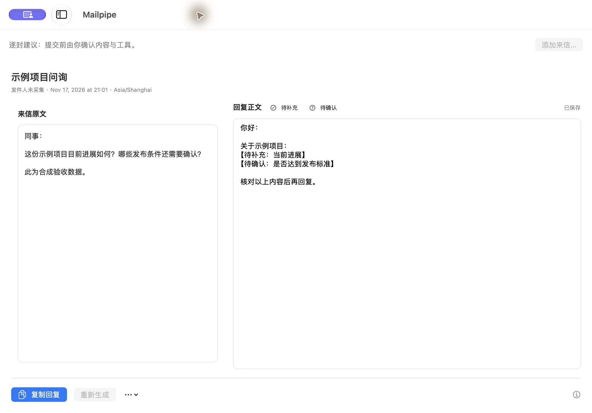
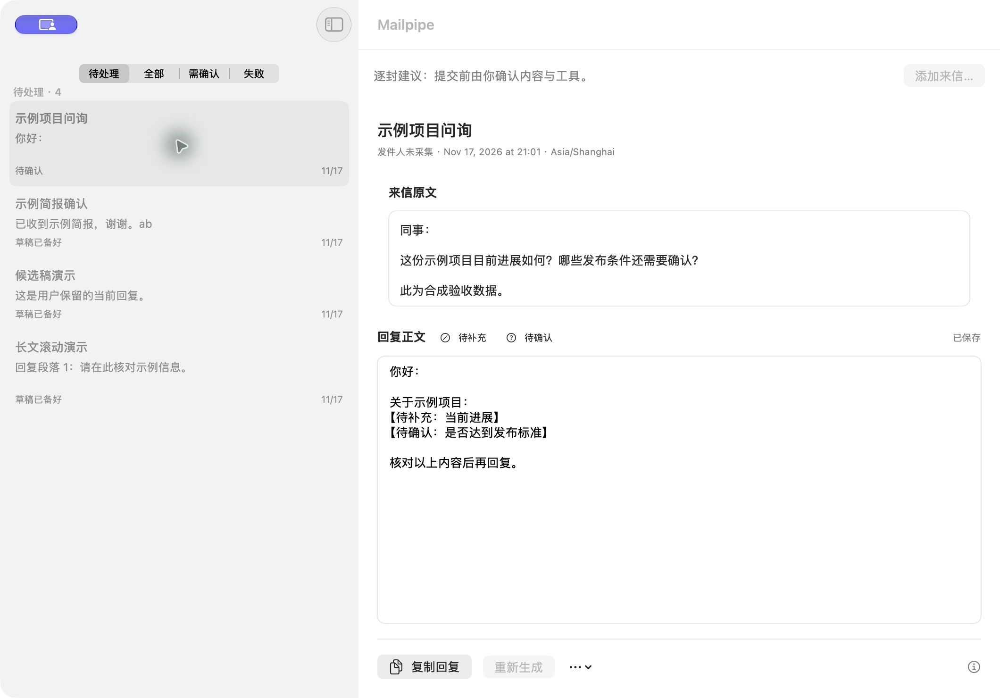
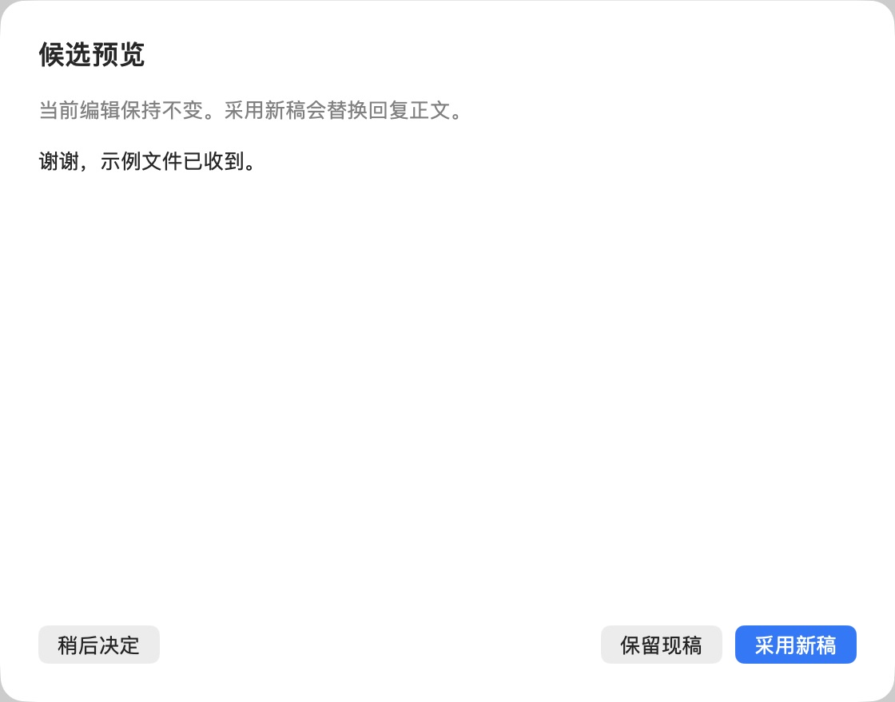
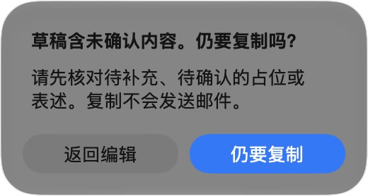

# 草稿详情 v1.2 验证

日期：2026-11-17（Asia/Shanghai）。
基线：`a52e642`，已合并的 PR #20。
分支：`codex/draft-detail-v12`。
范围：草稿详情与所属列表筛选位置。
不改变模型配置、账户范围或邮件处理管道。
未更新已安装的 build 13。

## 问题与实现

旧详情把回复主题作为输入框。
正文缺少编辑边界，动作随内容滚动。
未写盘缓冲属于详情视图，切换后可能丢失。

| 项目 | 本轮实现 |
|---|---|
| 页眉 | 静态来信主题、三级元信息，无主题输入框 |
| 原文 | 默认展开、只读、独立滚动 |
| 回复 | 原生 TextEditor，标签、边框、焦点和空态 |
| 布局 | 宽区左右约 38% / 62%；窄区上下排列 |
| 操作 | 固定底部，长文滚动不带走按钮 |
| 状态 | 占位提示、核对提示和保存状态靠近回复标题 |
| 去向 | 通过更多菜单或 info 打开，不常驻正文 |
| 筛选 | 移到列表导航区域，退出详情中心工具栏 |

宽窄依据详情的可用宽度切换。
最低系统仍为 macOS 13。
使用系统 [TextEditor](https://developer.apple.com/documentation/swiftui/texteditor)。
未把用户提供的结构稿当成运行截图。

## 保存与候选稿

编辑缓冲由宿主模型按邮件持有。
写盘任务也由宿主持有，不依附详情视图。
成功写入后才显示“已保存”。
失败保留缓冲，显示“未能保存，点此重试”。
切换邮件和关闭工作台不删除失败缓冲。
恢复写入后，由用户主动重试。
没有新增后台重试或通用锁。

重新生成前保存当前正文快照。
生成结果与当前编辑分离，需选择采用或保留。
候选选择写盘后记录版本，重开不会重复提示。
版本由现有运行 ID 和内容摘要组成。
候选变更时拒绝采用过期版本。
同一内容再次生成，也识别为新一轮候选。
复制只取当前编辑正文，包含未写盘的当前缓冲。
占位或已知待核实表述会先弹出确认。
复制不清空、不跳页，也不标为发送。

沿用已有暂停、授权核验和有界重生成。
不增加自动模型调用或未授权工具回退。
丢弃仍只影响当前草稿，沿用短时撤销。

## 自动回归

| 命令 | 结果 |
|---|---|
| `./scripts/build-app.sh` | `BUILD SUCCEEDED`，两种桌面架构 |
| `./scripts/test.sh --filter MailpipeRuntimeTests` | 39 项通过 |
| `git diff --check` | 通过 |

回归使用临时数据库与 fake 模型。
真实 Harness 意外调用日志为空。
覆盖写入失败、最新缓冲重试、存储重开。
覆盖占位约定、候选采用和保留、版本失效。
覆盖新一轮相同输出与保留编辑。
已有暂停、撤权、取消和次数限制回归通过。
日志只保留在 `.build/detail-v12-review/`。
本轮未运行云端 CI。

## 本机交互验收

系统：macOS 27.0.1（26A434）。
工具：Xcode 27.2（27B52）、macOS 27.2 SDK。
运行本地未签名候选包，版本仍为 build 13。
使用独立队列、固定合成来信和草稿。
未连接真实邮箱、模型或消息通道。
未修改已安装 App、正式队列及账户权限。
隔离测试宿主已退出。

| 项目 | 观察结果 |
|---|---|
| 输入 | 光标进入回复正文后可直接输入字符 |
| 剪贴板 | 将复制结果粘入另一份合成草稿，仅含原回复正文 |
| Undo | 粘贴后按 ⌘Z 恢复原回复 |
| 占位确认 | 含待补充、待确认时出现复制前提醒 |
| 保存失败 | 临时库触发器拒绝写入；界面显示重试，不显示已保存 |
| 切换与关窗 | 未写盘字符仍保留，可返回编辑 |
| 主动重试 | 移除失败触发器后，点击重试成功写入 |
| 进程重启 | 成功保存后终止隔离进程，重开仍有已保存字符 |
| 候选 | 固定候选预览显示采用、保留；保留后现稿不变 |
| 长文 | 原文与回复分别滚动，固定动作栏仍可见 |
| 窄详情区 | 扩大侧栏后，详情自动改为上下布局 |

候选界面使用固定数据验证。
真实重生成的候选状态流用 fake 模型回归验证。
没有为实机交互调用真实模型。
本轮真实模型调用、token、输入输出字符、费用均为 0。

## 运行截图

截图均来自本机构建与合成数据。
宽区截图使用系统隐藏侧栏后的详情视图。
窄区截图通过扩大侧栏收窄详情区域。

## 限制

- 占位符与待核实表述只做文本约定识别。
- 不代表语义完整性检查或事实核验。
- 不改写已有回复，也不编造进度或承诺。
- 本轮不修改模型提示词，不能保证模型生成占位符。
- 保存失败的未写盘缓冲仅在当前宿主会话保留。
- 已明确保存的内容可在进程重启后恢复。
- 原生 Undo 不提供跨邮件、跨进程历史浏览器。
- 发件人仍未采集；时间仍为采集时间。
- 超过既有七日有效期时仍需重新确认内容。
- 取消不会保证已启动的模型进程立即终止。
- 深色、降低透明度和 VoiceOver 朗读未在本轮重测。
- macOS 13/14 实机未测，不宣称完整平台验收。
- 不提供 Mail 填充、Mail 交接按钮或自动发送。
