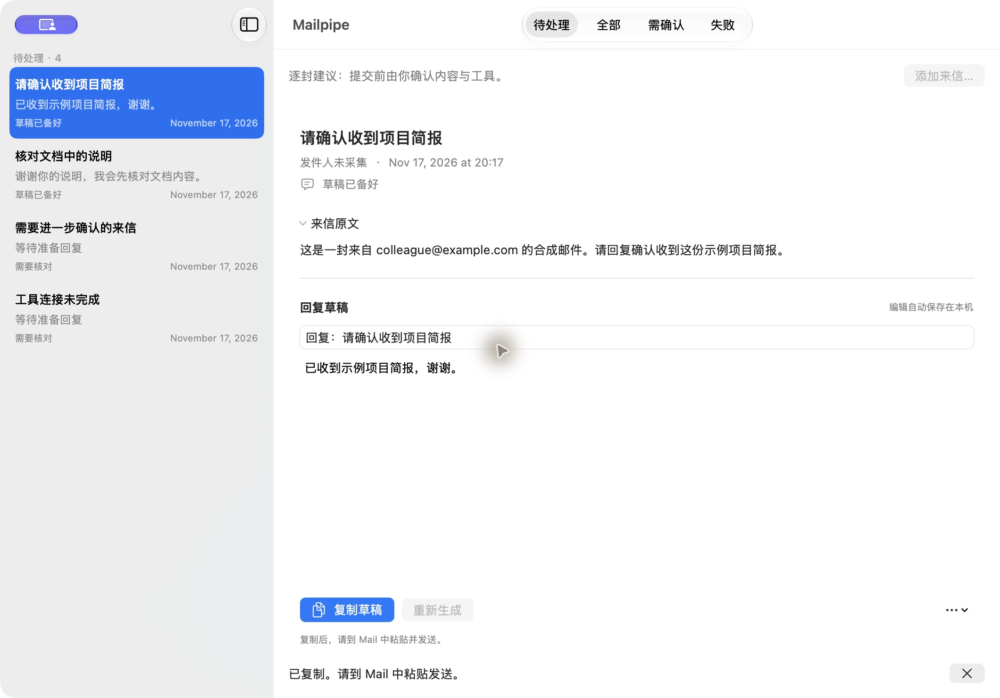
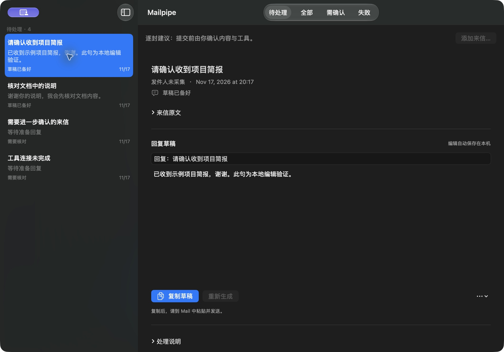
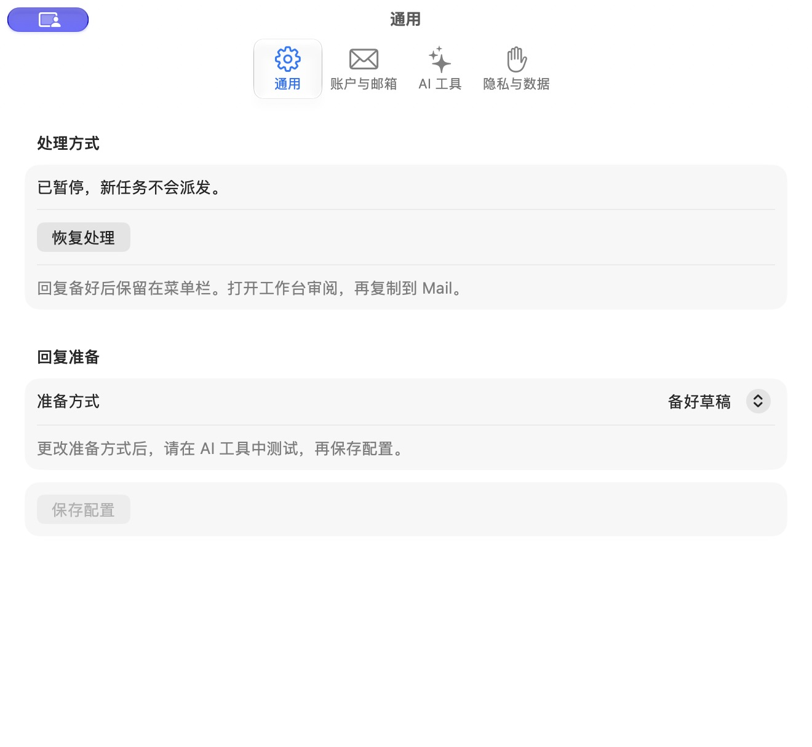
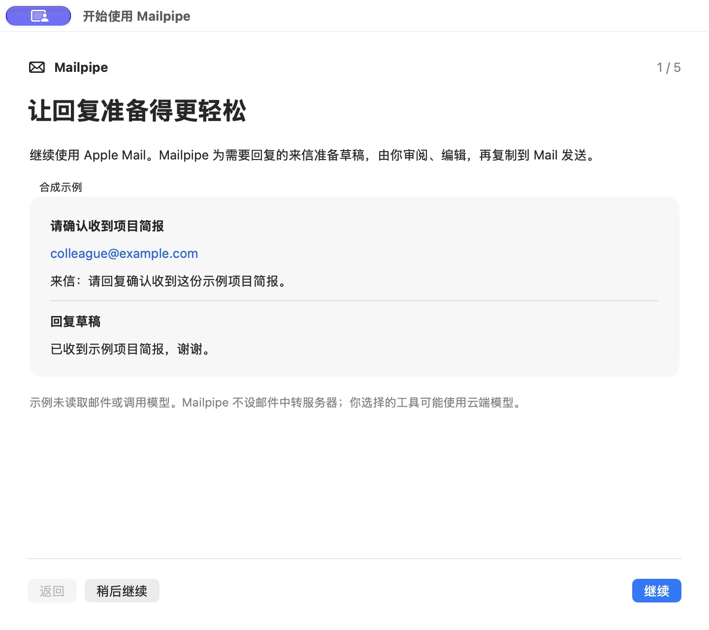

# 原生 UI 重做验证

日期：2026-11-17（Asia/Shanghai）。
状态：本地实现与部分实机验证完成。
分支：`codex/native-mailpipe-ui`。
基线：`9802501`。
代码与验证记录随本分支提交，PR 不自动合并。
用户随后授权本地更新；已安装开发签名 build 13。

## 范围与依据

产品范围依据用户提供的 UI 交接 Markdown。
交互补充来自 [Notion 方案](https://app.notion.com/p/41b632b374f5810c9da8e9c8943d518b)。
视觉核对了 [Figma 窗口组件](https://www.figma.com/design/uP6U294t3QZEQc8WY5137x/?node-id=4440-8165)。
该文件是 Community 副本，未认定为官方发布。
未使用旧线框或第三方后台截图实现视觉。

采用系统 `NavigationSplitView`、侧栏列表和工具栏。
设置使用标准 `Settings` scene 与表单。
正文使用系统文本背景，不铺装饰玻璃。
系统负责材质、选中态和窗口形状。
参考 [Apple NavigationSplitView](https://developer.apple.com/documentation/swiftui/navigationsplitview)。
最低系统仍为 macOS 13，未提高。
`SettingsLink` 在 macOS 14 以下使用设置窗口动作降级。

## 文件与行为

| 文件 | 改动 |
|---|---|
| `Mailpipe/App/MailpipeApp.swift` | 菜单栏优先启动、首启引导、标准设置窗 |
| `Mailpipe/App/PendingWorkbench.swift` | 分栏、筛选、编辑、复制、恢复和状态反馈 |
| `Mailpipe/App/OnboardingView.swift` | 精简五步引导，按需读取账户 |
| `Mailpipe/App/ManualSuggestionView.swift` | 保留逐封确认，移除常驻路径和路由名 |
| `Packages/MailpipeRuntime/Sources/PipelineStore.swift` | 编辑、丢弃时间和重生成计数持久化 |
| `Packages/MailpipeRuntime/Sources/ReplyPipeline.swift` | 有界显式重生成与授权复核 |
| `Packages/HarnessAdapters/Sources/CLIAdapter.swift` | 已有记忆的口吻提示，中性专业降级 |
| `Tests/MailpipeRuntimeTests/PipelineTests.swift` | 编辑、撤销、重生成和授权回归 |
| `docs/interaction-design.md` | 标记旧线框及未实现入口 |
| `docs/validation/2026-11-17-native-ui.md` | 本轮范围与验证记录 |
| `docs/validation/assets/native-ui-20261117/*.jpg` | 四张合成数据运行截图 |

工作台工具栏只有四个视图分段。
详情可展开来信原文；处理说明默认折叠。
主操作是复制；不会清空结果或标记发送。
丢弃只隐藏本地记录，不删除来信。
撤销窗口为 15 秒，不触发偏好学习。

重新生成由用户确认，每封最多三次。
每次最多两次模型调用，不自动重试。
所有者是原队列记录；重复点击不重复入队。
记录已有在途调用时，禁止再生成。
启动时不恢复未知调用或自动换工具。
捕获邮件重新生成前，重新核对原邮件身份。
重生成遵守当前准备方式和账户授权。
原编辑始终保留；新稿由用户明确选择后替换。
失败、取消和暂停均不清除编辑。
取消不会保证已启动的模型进程立即终止。

已有记忆仅允许影响口吻与重点。
提示词不授予文件、Shell 或 Mail 权限。
没有新增画像 UI，也没有改变模型配置。
真实记忆加载能力仍未验证。

## 自动验证

| 命令 | 结果 |
|---|---|
| `./scripts/build-app.sh` | `BUILD SUCCEEDED`，arm64 与 x86_64 |
| `./scripts/test.sh --filter 'MailpipeRuntimeTests\|HarnessAdaptersTests'` | 34 个 Runtime、17 个 Adapter 测试通过 |
| `git diff --check` | 通过 |

测试使用临时数据库和 fake 模型。
真实 Harness 意外调用日志为空。
原始日志位于本地 `.build/ui-review/`，不进入 Git。
本轮未运行云端 CI。

新增回归覆盖：

- 旧记录解码与编辑持久化。
- 丢弃撤销及 15 秒时限。
- 重生成防重入与三次上限。
- 暂停、撤权、当前准备方式。
- 模型失败、取消后保留编辑。
- 取消中的调用完成前禁止再生成。

## 首轮隔离界面验证

系统：macOS 27.0.1（26A434）。
工具：Xcode 27.2（27B52）、macOS 27.2 SDK。
该阶段运行本地未签名候选包，未覆盖已安装 App。
版本保持 0.0.1 / build 12；entitlements 未改。
该阶段未验证签名与 Mail 扩展集成。

实机数据为独立队列中的合成来信。
未连接真实邮箱、模型或消息通道。
原账户授权、暂停和正式队列未改。
该阶段结束后退出测试宿主；后续更新见文末。

| 项目 | 结果 |
|---|---|
| 浅色和深色 | 已观察本机构建界面 |
| 首次启动 | 自动打开引导，连接前不能继续 |
| 已配置启动 | 不自动打开工作台 |
| 来信原文 | 可展开合成正文 |
| 复制 | 显示去 Mail 粘贴发送提示 |
| 编辑 | 切换来信与重启后保留 |
| 丢弃与撤销 | 列表移除后恢复，编辑保留 |
| 设置 | `⌘,` 打开标准设置窗 |
| 键盘 | `⌘1` 打开工作台，Tab 可进入主题 |
| 辅助技术标签 | AX 可读到编辑器与更多操作标签 |

深色验收仅覆盖隔离进程外观，不改系统设置。
隔离模式可加 `--open-workbench` 打开窗口。
`--ui-dark` 只在指定隔离目录时生效。
它们是验收参数，不是产品功能开关。

### 运行截图

以下均来自本机构建与合成数据。
截图不包含私人邮件、账户或路径。

## 限制与未测项

- 不做 Apple Mail 撰写窗口填充或自动发送。
- 未提供任何“在 Mail 中打开”控件。
- 队列不保存发件人，界面明确提示未采集。
- 显示时间为采集时间，未声明为发件时间。
- 来信原文是已采集的可阅读正文，不是完整 MIME。
- 过期及来源错误来自现有核验，不后台监听原邮件变化。
- 真实工具连接、权限拒绝及多账户 UI 未重测。
- 菜单栏最近项、暂停按钮未逐项实机点击。
- 降低透明度和 VoiceOver 朗读未实机验收。
- 窄窗口、长正文与 macOS 13/14 降级未实机验收。
- 撤销入口是当前会话提示，重启后不恢复提示。
- 丢弃记录仍占本地队列容量；本轮不增加清理机制。
- 本轮不是上线闭环或发布验收。

真实模型调用数为 0，真实模型 token 为 0。
实际调用输入输出字符为 0，实付金额为 0。
fake 返回的 token 仅用于回归，不代表真实用量。

## 用户授权后的本地更新

同日按用户要求更新已安装 App，并打开工作台。
宿主与扩展均为 0.0.1 / build 13。
沿用原团队、Bundle ID、App Group 和 entitlements。
开发签名构建与严格签名校验均通过。
构建使用 `scripts/build-app.sh` 与原开发团队参数。
产物位于本地 `.build/ui-signed/`。

更新前正常退出 Mail，宿主原已退出。
当时无在途任务，也无待导入采集文件。
旧包、队列与共享采集目录已备份至本机私有目录。
本轮手动更新原安装路径，没有新增安装脚本。
未修改账户授权或暂停，不重放历史失败记录。
更新前后数据库三张表逐项一致。

Mail 与新版宿主已恢复运行。
已打开正式工作台和一份现有草稿供用户查看。
未触发重新生成、复制、发送或邮件写操作。
未把正式邮件界面截图写入仓库。
`--open-workbench` 可显式打开工作台。
普通配置完成后的启动仍不自动打开窗口。

此项验证更新安装与现有草稿展示。
不代表重新验收新邮件到模型的完整链路。
